# Arquitectura de Entreno

Documentación técnica de la app: capas, pantallas y navegación, base de datos, flujos y lo que corre en segundo plano. Describe **lo que hace el código**; los requisitos y las decisiones están en [PLAN.md](PLAN.md) y las normas de trabajo en [AGENTS.md](AGENTS.md). Si este documento y el código no coinciden, manda el código (y hay que corregir esto).

| | |
|---|---|
| Versión de la app | **1.4.6** (`versionCode` 18, [app.json](app.json)) |
| Esquema de la BD | **10** (`PRAGMA user_version`, 10 migraciones) |
| Revisado | 2026-11-06, versión 1.4.6 (series de tiempo, importadas, ejercicios archivados, ejercicio suelto desde el catálogo) |

**Índice**: [1. Capas](#1-resumen-y-capas) · [2. Pantallas](#2-pantallas) · [3. Mapa de navegación](#3-mapa-de-navegación) · [4. Base de datos](#4-base-de-datos) · [5. Flujos](#5-flujos-principales) · [6. Segundo plano y nativo](#6-segundo-plano-y-nativo) · [7. Mantener este documento](#7-cómo-mantener-este-documento)

---

## 1. Resumen y capas

App Android personal (un usuario, sin servidor) para entrenar fuerza con progresión de cargas, grabar cardio (GPS, fases, sprints), llevar la dieta y el perfil corporal, con copia de seguridad en GitHub. Todo vive en una SQLite cifrada en el móvil.

### 1.1 Pila

| Pieza | Qué se usa |
|---|---|
| Framework | Expo SDK 58 · React Native 0.88 · React 19.3 · TypeScript estricto · React Compiler (`experiments.reactCompiler`) |
| Navegación | `expo-router` (rutas en `src/app/`, `typedRoutes`): un `Stack` raíz con las pestañas JS (`expo-router/js-tabs`) dentro |
| Datos | `expo-sqlite` con **SQLCipher** y SQL escrito a mano; migraciones con `PRAGMA user_version` |
| Avisos | `expo-notifications` (solo locales: `DATE` con `alarmClock` y `WEEKLY`) + módulo nativo propio `modules/rest-timer` |
| GPS | `expo-location` + `expo-task-manager` (servicio en primer plano) |
| Secretos | `expo-secure-store` (Keystore): clave de la BD, clave de las copias, token de GitHub |
| Gráficas y mapas | `react-native-svg` (propias), `react-native-webview` + MapLibre GL JS (mapa 3D), teselas OSM/PNOA |
| Fotos | `expo-image-picker` (cámara y selector de fotos del sistema), `expo-image-manipulator` (copia reducida a 2160 px), `expo-file-system` (carpeta `Documents/photos/`) |
| Builds y firma | `expo prebuild` + Gradle; release firmado con la clave propia ([withReleaseSigning.js](plugins/withReleaseSigning.js)) y la prueba de rotación desde la clave pública de la plantilla ([sign_release.py](scripts/sign_release.py), [entreno-rotation.lineage](signing/entreno-rotation.lineage)); ver AGENTS.md |
| Otros | `react-native-body-highlighter` (silueta), `react-native-view-shot` + `expo-sharing` + `expo-media-library` (imagen para compartir), `expo-crypto` (AES-GCM), `date-fns` |

### 1.2 Carpetas

| Carpeta | Qué contiene | Regla |
|---|---|---|
| [src/app/](src/app/) | Rutas de expo-router (nombres en español). Cada fichero es una pantalla. | Solo UI: lee y escribe a través de repositorios, hooks y servicios. |
| [src/components/](src/components/) | Sistema de diseño ([ui.tsx](src/components/ui.tsx)), capas ([Dialog.tsx](src/components/Dialog.tsx), [Sheet.tsx](src/components/Sheet.tsx)) y piezas compuestas (tarjetas, gráficas, mapas). | Igual que las pantallas. ESLint prohíbe `Text` de RN, colores literales y tamaños numéricos. |
| [src/hooks/](src/hooks/) | `useDb`, `useLoader`, `useNow` ([data.ts](src/hooks/data.ts)); escrituras en cola y guardado ([editing.ts](src/hooks/editing.ts)); sesión de cardio en vivo ([walk.ts](src/hooks/walk.ts)). | |
| [src/db/](src/db/) | Interfaz `Db` ([db.ts](src/db/db.ts)), [migrations.ts](src/db/migrations.ts), [seed.ts](src/db/seed.ts), copias y borrado ([maintenance.ts](src/db/maintenance.ts)), datos de prueba (`demo*.ts`). | Depende solo de `src/domain` (y de los JSON de `data/seed`). Testeado con `node:sqlite`. |
| [src/db/repositories/](src/db/repositories/) | Un repositorio por área, con SQL tipado. | Única puerta a SQLite desde la UI. |
| [src/domain/](src/domain/) | Lógica pura: progresión, máquina del entreno, nutrición, GPS, sprints, músculos, cifrado de copias, formatos. | **TS puro**: sin React Native ni Expo (solo `date-fns`). Siempre con tests. |
| [src/services/](src/services/) | Notificaciones, temporizadores, GPS, copias, cifrado, fotos, imagen para compartir. | Único sitio que toca `expo-notifications`, `expo-location`, la cámara y el selector de fotos, el módulo nativo y la red. |
| [modules/rest-timer/](modules/rest-timer/) | Módulo nativo Kotlin: cuenta atrás en la pantalla de bloqueo, «Entreno en curso», burbuja, pitido de los sprints, PBKDF2. | Solo lo llaman los servicios. |
| [data/seed/](data/seed/) | `catalog.json` (22 ejercicios y alimentos, va en la app) y `seed.json` (datos del Excel, solo pruebas). | |
| [scripts/](scripts/) | Iconos, simulación de sprints en el emulador, descifrar una copia en el ordenador. | |

### 1.3 Reglas entre capas

- Las pantallas y componentes **no ejecutan SQL**: usan `src/db/repositories/` (comprobado: ningún `runAsync`/`getAllAsync`/`execAsync` en `src/app`, `src/components` ni `src/hooks`, salvo el `PRAGMA key` y `migrate()` que lanza [_layout.tsx](src/app/_layout.tsx) al abrir la BD).
- Las notificaciones y el módulo nativo **solo desde `src/services/`**. Excepción: [_layout.tsx](src/app/_layout.tsx) importa `expo-notifications` para escuchar el toque en una notificación y navegar.
- `src/domain/` no importa nada de React Native ni de Expo; recibe `now` como parámetro.
- Las pantallas no llaman a `Date.now()` para escribir: repositorios y servicios reciben `now` con valor por defecto.
- Unidades: kg, fechas locales `YYYY-MM-DD`, instantes en epoch ms, día de la semana ISO (1 = lunes). La conversión a la convención de `expo-notifications` (1 = domingo) solo está en [dailyReminder.ts](src/services/dailyReminder.ts) (`isoToExpoWeekday`).
- Todo cambio en rutinas, slots, días o cardio llama a `reschedule(db)` ([editing.ts](src/hooks/editing.ts)) → `rescheduleDailyReminders()`.

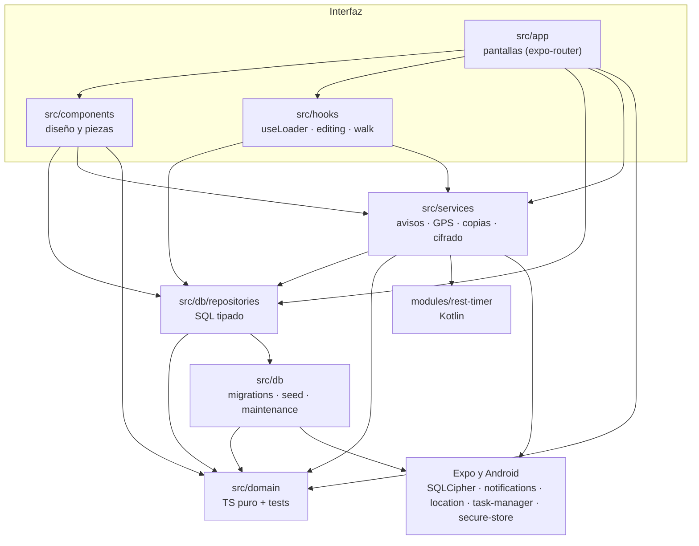

### 1.4 Arranque de la app

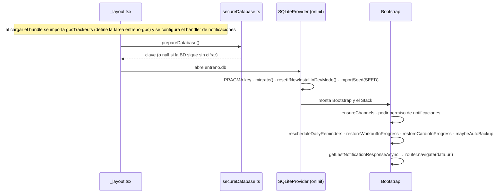

Mientras `prepareDatabase()` no responde se ve una vista vacía del color de fondo. `SnackbarHost` y `DialogHost` (diálogos, menús ⋮ y diálogos de texto) cuelgan del layout raíz, por encima del `Stack`.

### 1.5 Patrones transversales

| Patrón | Dónde | Qué hace |
|---|---|---|
| `useLoader(load)` | [data.ts](src/hooks/data.ts) | Carga al enfocar la pantalla y al volver la app a primer plano; `reload()` tras escribir. No hay estado global: la BD es la fuente de verdad. |
| `queueWrite(task)` | [editing.ts](src/hooks/editing.ts) | Encadena las escrituras de los editores para no abrir dos transacciones a la vez. |
| `useSavedAtOnce` | editing.ts | Controles que guardan al momento (días de una rutina, rutina en un día). |
| `useSaveGuard(dirty, save)` | editing.ts | Formularios con un «Guardar»: al salir con cambios, «¿Guardar los cambios?». Devuelve `leave()` (`back`, o `replace('/rutinas')` si no hay historial). |
| `emitDataChanged` / `useOnDataChanged` | editing.ts | Recarga pantallas abiertas tras un «Deshacer» de Snackbar. |
| `showDialog`, `showActions` (⋮), `showPrompt`, `showSnackbar` | [Dialog.tsx](src/components/Dialog.tsx) | Capas propias (nunca la alerta del sistema). |
| `Sheet` | [Sheet.tsx](src/components/Sheet.tsx) | Hoja inferior sin campos de texto. |
| `BottomBar` con `actionKey` | [ui.tsx](src/components/ui.tsx) | Acción principal fija abajo; ignora toques 600 ms al cambiar (doble toque). |
| `layers.ts` | [layers.ts](src/components/layers.ts) | Altura de la barra inferior y de las pestañas, para colocar el Snackbar encima. |

### 1.6 Inventario de módulos

<details>
<summary><b>Repositorios</b> (src/db/repositories)</summary>

| Fichero | Tablas | Funciones principales |
|---|---|---|
| [routines.ts](src/db/repositories/routines.ts) | `routine`, `routine_weekday`, `routine_slot` | `listRoutines`, `listSlots`, `createRoutine`, `renameRoutine`, `setRoutineWeekdays`, `setRoutineOnWeekday`, `archiveRoutine`, `addSlot`, `updateSlotPrescription`, `archiveSlot`, `moveSlot`, `looseSlotFor` (la ficha de un ejercicio suelto; los que no están en ninguna rutina, en la oculta `LOOSE_ROUTINE`) |
| [sessions.ts](src/db/repositories/sessions.ts) | `workout_session`, `set_log` (y `weight_change` al terminar) | `startSession`, `startLooseSession`, `addLooseExercise`, `sessionSlots`, `logSet`, `logWarmupSet`, `deleteSet`/`restoreSet`, `finishSession`, `refreshRecommendations`, `discardSession`, `deleteFinishedSession`, `openNextSet`, `finishedSessionsOn` |
| [weightChanges.ts](src/db/repositories/weightChanges.ts) | `weight_change`, `routine_slot.weight_kg` | `listOpenChanges`, `createRecommendation`, `applyChange`, `dismissChange`, `undoChange`, `setSlotWeightManually`, `expireOpenChanges` |
| [exercises.ts](src/db/repositories/exercises.ts) | `exercise` | `listExercises`, `createExercise` (recupera uno archivado con el mismo nombre), `updateExercise`, `archiveExercise`, `listArchivedExercises`, `isExerciseArchived`, `restoreExercise` |
| [muscles.ts](src/db/repositories/muscles.ts) | `exercise_muscle` (+ lecturas de `set_log` y `routine_slot`) | `allExerciseMuscles`, `setExerciseMuscles`, `workSetsBetween`, `workSetsOfSession`, `loadMuscleWeek`, `plannedWeekSets` |
| [progress.ts](src/db/repositories/progress.ts) | lecturas | `workoutHistory`, `exerciseSessions`, `exercisesWithHistory`, `exerciseWeightChanges`, `exerciseUnit` (reps, segundos o pasos, según sus fichas), `cardioEntries` |
| [cardio.ts](src/db/repositories/cardio.ts) | `cardio_activity`, `cardio_log` | `listCardio`, `cardioLogOn`, `setCardioDone`, `addCardio`, `updateCardio`, `archiveCardio`, `unarchiveCardio` |
| [cardioSessions.ts](src/db/repositories/cardioSessions.ts) | `cardio_session`, `cardio_point`, `cardio_log` | `startCardioSession`, `addTrackPoints`, `pause/resumeCardioSession`, `finishCardioSession`, `setSprintLaps` (bloqueo optimista), `listSprintFixes`, `finishSprintSession`, `setCardioTitle`, `discardCardioSession` |
| [diet.ts](src/db/repositories/diet.ts) | `food`, `diet_item` | `listFoods`, `createFood`, `updateFood`, `archiveFood`, `listDietItems`, `addDietItem`, `updateDietItemGrams`, `removeDietItem`/`restoreDietItem`, `copyDietDay`/`restoreDietDays` |
| [settings.ts](src/db/repositories/settings.ts) | `settings`, `profile`, `weight_log` | `getSettings`, `updateSettings`, `getProfile`, `updateProfile`, `listWeights`, `listWeightsPage`, `logWeight`, `deleteWeight`, `loadNutritionTargets` |
| [photos.ts](src/db/repositories/photos.ts) | `photo` | `addPhoto`, `listPhotos` (por orden en que se hicieron), `getPhoto`, `deletePhoto`, `photoFilesOf`, `allPhotoFiles` |
| [hints.ts](src/db/repositories/hints.ts) | `app_meta` (`hint:*`) | `hintsSeen`, `markHintSeen` (`walk-metric`, `walk-chart`, `sprint-how`) |
| [admin.ts](src/db/repositories/admin.ts) | `app_meta` (`admin`) | `getAdminOptions` (la primera vez, sí si ya hay copia en GitHub o modo pruebas), `setAdminOptions` |

</details>

<details>
<summary><b>Dominio</b> (src/domain, TS puro)</summary>

| Fichero | Qué resuelve |
|---|---|
| [progression.ts](src/domain/progression.ts) | `recommend()`: subir, bajar o mantener el peso de un slot (PLAN §6.2) |
| [workoutMachine.ts](src/domain/workoutMachine.ts) | `setsDone`, `nextPendingSlot`, `nextStep`, `slotToOpen`, `looseSlotIds` |
| [warmup.ts](src/domain/warmup.ts) | Propuesta de aproximaciones (50 % × 10, 70 % × 5, 85 % × 3 o las de la última vez) |
| [nutrition.ts](src/domain/nutrition.ts) | Edad, TMB, gasto, objetivos, macros, desviación (PLAN §4–5) |
| [bodyProfile.ts](src/domain/bodyProfile.ts) | Objetivo Perder/Mantener/Ganar ↔ `deficit_kcal`, niveles de actividad, qué falta del perfil |
| [schedule.ts](src/domain/schedule.ts) | Días ISO, fechas locales, `buildDailyMessage`, `isoToExpoWeekday`, frase de ánimo |
| [muscles.ts](src/domain/muscles.ts) | 18 músculos, series por músculo (1 / 0,5), niveles, `CATALOG_MUSCLES`, búsqueda por músculo, patrón de movimiento |
| [progress.ts](src/domain/progress.ts) | Volumen, récords, 1RM estimado (Epley, hasta 12 reps), escalas de ejes, agrupar por meses |
| [cardioPlan.ts](src/domain/cardioPlan.ts) | Planes LISS/MISS/HIIT → fases y alarmas; `sharesLockCountdown` |
| [cardioPool.ts](src/domain/cardioPool.ts) | «Hacer otro cardio»: agrupar y filtrar el cardio de otros días |
| [gps.ts](src/domain/gps.ts) | Filtrado, distancia, tramos, muestras, parciales, polilínea |
| [walkStats.ts](src/domain/walkStats.ts) | Cifras del panel de la caminata |
| [trackChart.ts](src/domain/trackChart.ts) | Series, zoom y escalas de la gráfica de la ruta |
| [mapView.ts](src/domain/mapView.ts) | Teselas de OSM y encuadre del mapa estático |
| [sprint.ts](src/domain/sprint.ts) | Estado de los sprints a partir de las vueltas, transiciones y medición GPS |
| [photos.ts](src/domain/photos.ts) | Fecha y GPS del EXIF de una foto y dónde va en la ruta (`placeFromFix`, `placeAtTime`, `photoPlace`, `walkTrackOf`); imágenes sin sesión (`photosWithoutSession`) |
| [secretTaps.ts](src/domain/secretTaps.ts) | Siete toques en la versión para ver u ocultar las opciones de administrador (`addTap`, `tapOutcome`) |
| [backupCipher.ts](src/domain/backupCipher.ts) | Formato de copia cifrada, PBKDF2/AES con un «kit» inyectado |
| [format.ts](src/domain/format.ts) | Formatos es-ES (kg, duraciones, fechas, tamaños de fichero, series con su unidad `formatSetGroups`/`formatSetValues`, `workoutTitle`) |
| [types.ts](src/domain/types.ts) | Tipos compartidos (`IsoWeekday`, `RepTarget`, `Recommendation`…) |

</details>

<details>
<summary><b>Servicios</b> (src/services)</summary>

| Fichero | Qué hace | Lo usan |
|---|---|---|
| [notifications.ts](src/services/notifications.ts) | Handler, canales, permisos, abrir ajustes de Android, `resetNotifications` | `_layout`, Ajustes, backup, entreno |
| [restTimer.ts](src/services/restTimer.ts) | Alarma `rest-<sesión>` + cuenta atrás nativa del descanso | Entreno, Hoy |
| [workoutInProgress.ts](src/services/workoutInProgress.ts) | Notificación fija «Entreno en curso» y sus textos | Entreno, Hoy, `_layout` |
| [dailyReminder.ts](src/services/dailyReminder.ts) | Los 7 avisos semanales | `_layout`, Ajustes, `editing.ts`, backup |
| [cardioSession.ts](src/services/cardioSession.ts) | Iniciar, pausar, reanudar, terminar y descartar cardio | Hoy, sesión de cardio, `_layout` |
| [cardioTimer.ts](src/services/cardioTimer.ts) | Alarmas de cambio de fase | cardioSession, sprintSession |
| [sprintSession.ts](src/services/sprintSession.ts) | Acciones de los sprints, pitido y cuenta atrás | `SprintLive`, cardioSession |
| [gpsTracker.ts](src/services/gpsTracker.ts) | Tarea `entreno-gps` y arrancar/parar el GPS | cardioSession, sprintSession, `walk.ts`, `_layout` |
| [secureDatabase.ts](src/services/secureDatabase.ts) | Clave SQLCipher, cifrar una BD antigua, conexión de la tarea GPS | `_layout`, gpsTracker |
| [backup.ts](src/services/backup.ts) | Exportar/importar, GitHub, modo pruebas, contraseña de las copias | Ajustes, Cifrado, Hoy, entreno, cardio, `_layout` |
| [backupCipher.ts](src/services/backupCipher.ts) | Kit nativo (PBKDF2 del módulo + AES-GCM de `expo-crypto`) y la clave guardada | backup |
| [githubBackup.ts](src/services/githubBackup.ts) | API de contenidos de GitHub (GET sha, PUT, descarga raw) | backup |
| [photos.ts](src/services/photos.ts) | Hacer una foto o elegirla de la galería, guardar su copia reducida, quitarla y borrar las de una sesión; recuperar la que Android dejó a medias (`recoverPendingPhotos`); imágenes sin sesión | Sesión de cardio, Resumen, Foto, Compartir, cardioSession |
| [shareImage.ts](src/services/shareImage.ts) | Captura de una vista, guardar en la galería, compartir | Compartir |
| [network.ts](src/services/network.ts) | ¿Se pueden cargar teselas ahora? | Compartir |

</details>

<details>
<summary><b>Componentes</b> (src/components)</summary>

| Fichero | Qué es |
|---|---|
| [ui.tsx](src/components/ui.tsx) | Sistema de diseño: `AppText`, `Value`, `Screen`, `BottomBar`, `Card`, `ListGroup`/`ListRow`, `Section`, `Button`, `Segmented`, `DayPicker`, `Stepper`, `NumberRow`, `TextField`, `DateField`, `TimeField`, `DurationField`, `Tag`, `CheckMark`, `EditableTitle`, `ExerciseIcon`, `Figure`, `ROW_ICON_INSET`, `EmptyState`… |
| [Dialog.tsx](src/components/Dialog.tsx) · [Sheet.tsx](src/components/Sheet.tsx) · [layers.ts](src/components/layers.ts) | Diálogo, menú ⋮, diálogo de texto, Snackbar; hoja inferior; colocación de capas |
| [RoutineCard.tsx](src/components/RoutineCard.tsx) · [Recommendation.tsx](src/components/Recommendation.tsx) | Tarjeta de rutina (modos Hoy y Rutinas); cajas y líneas de sugerencia de peso |
| [SlotRow.tsx](src/components/SlotRow.tsx) | Un ejercicio de una rutina como fila: icono, nombre, la carga como cifra a la derecha («35 kg», «15 kg / lastre») y la prescripción debajo. Rutinas, Hoy, editor de rutina y «Ejercicio suelto» |
| [Ring.tsx](src/components/Ring.tsx) | Anillo del descanso (Reanimated) |
| [LineChart.tsx](src/components/LineChart.tsx) · [TrackChart.tsx](src/components/TrackChart.tsx) · [MetricBoard.tsx](src/components/MetricBoard.tsx) | Gráfica de progreso/peso; gráfica de la ruta; panel de cifras de la caminata |
| [RouteMap.tsx](src/components/RouteMap.tsx) · [InteractiveMap.tsx](src/components/InteractiveMap.tsx) | Mapa estático SVG sobre teselas OSM, con una cámara donde se hizo cada foto (y miniatura); MapLibre en un WebView |
| [ShareCard.tsx](src/components/ShareCard.tsx) | Imagen de caminata y de entreno: historia 1080 × 1920 o cuadrado 1080 × 1080 (`FRAMES`), estilos Mapa · Foto · Oscuro · Sin fondo con la ruta en el mismo sitio en los tres primeros (en Mapa, zoom entre niveles con `fitViewExact`); la marca y «© OpenStreetMap» en la última línea |
| [Photos.tsx](src/components/Photos.tsx) | Fotos de una sesión: tira de miniaturas con «Añadir» (o la fila «Añadir foto»), menú «Hacer una foto» · «Elegir de la galería» |
| [Sprint.tsx](src/components/Sprint.tsx) · [SprintLive.tsx](src/components/SprintLive.tsx) | Tabla y detalle de sprints; pantalla en directo |
| [BodyMap.tsx](src/components/BodyMap.tsx) · [MuscleWeek.tsx](src/components/MuscleWeek.tsx) · [MusclePicker.tsx](src/components/MusclePicker.tsx) | Silueta (única que importa la librería); «Esta semana» del Perfil; hoja de músculos |
| [WeightSheet.tsx](src/components/WeightSheet.tsx) | Hoja de un pesaje |
| [DataSettings.tsx](src/components/DataSettings.tsx) | Secciones de Ajustes: copia de seguridad y modo pruebas |
| [FormRow.tsx](src/components/FormRow.tsx) · [SearchField.tsx](src/components/SearchField.tsx) | Fila de formulario; buscador |

</details>

---

## 2. Pantallas

### 2.1 Rutas

29 ficheros en `src/app/`: 2 layouts, 5 pestañas y 22 pantallas apiladas en el `Stack` raíz (todas registradas en [_layout.tsx](src/app/_layout.tsx) con su título por defecto; muchas lo cambian al cargar). Los parámetros van en la ruta (`:id`) o en la query (`?clave=valor`).

| Fichero | URL y parámetros | Título | Para qué |
|---|---|---|---|
| [_layout.tsx](src/app/_layout.tsx) | — | — | Raíz: BD cifrada, `Bootstrap`, `Stack`, hosts de diálogos y Snackbar |
| [(tabs)/_layout.tsx](src/app/(tabs)/_layout.tsx) | — | — | Barra de pestañas: Hoy · Rutinas · Historial · Dieta · Perfil |
| [(tabs)/index.tsx](src/app/(tabs)/index.tsx) | `/` | Fecha larga («Martes, 3 de noviembre») | **Hoy**: lo que toca, lo hecho y «hacer otra cosa» |
| [(tabs)/rutinas.tsx](src/app/(tabs)/rutinas.tsx) | `/rutinas` | Rutinas | Semana, rutinas con pesos y sugerencias, accesos a editores |
| [(tabs)/historial.tsx](src/app/(tabs)/historial.tsx) | `/historial` | Historial | Entrenos · Ejercicios · Cardio, por meses |
| [(tabs)/dieta.tsx](src/app/(tabs)/dieta.tsx) | `/dieta` | Dieta | Plan semanal y totales frente a objetivos |
| [(tabs)/perfil.tsx](src/app/(tabs)/perfil.tsx) | `/perfil` | Perfil | Esta semana (músculos), peso, objetivos, mis datos |
| [workout/[sessionId].tsx](src/app/workout/[sessionId].tsx) | `/workout/:sessionId` | Nombre de la rutina o «Ejercicio suelto» («Entrenando» mientras carga) | Modo entrenamiento: lista · serie · descanso |
| [workout/resumen/[sessionId].tsx](src/app/workout/resumen/[sessionId].tsx) | `/workout/resumen/:sessionId` · `?nuevo=1` recién terminado | Vacío (título editable en la página) o «Corregir series» | Resumen, sugerencias, corregir o borrar |
| [ejercicio-suelto.tsx](src/app/ejercicio-suelto.tsx) | `/ejercicio-suelto` · `?sesion=:id` para añadir a una sesión suelta | «Ejercicio suelto» o «Añadir otro ejercicio» | Elegir un ejercicio del catálogo |
| [progreso/[id].tsx](src/app/progreso/[id].tsx) | `/progreso/:exerciseId` | Nombre del ejercicio | Gráfica, récords, sesiones y cambios de peso |
| [cardio-sesion/[id].tsx](src/app/cardio-sesion/[id].tsx) | `/cardio-sesion/:cardioSessionId` | En directo: nombre o píldora del GPS; terminada: vacío | Caminata, Fases o Sprints en directo, o su detalle |
| [ruta/[id].tsx](src/app/ruta/[id].tsx) | `/ruta/:cardioSessionId` · `?modo=3d` | Sin cabecera | Mapa a pantalla completa con gráfica |
| [compartir/[tipo]/[id].tsx](src/app/compartir/[tipo]/[id].tsx) | `/compartir/cardio/:id` · `/compartir/entreno/:id` | Compartir | Imagen para compartir (historia o cuadrado) |
| [foto/[id].tsx](src/app/foto/[id].tsx) | `/foto/:photoId` | «Foto» o «2 de 5» | Las fotos de una sesión, una por página |
| [rutina/[id].tsx](src/app/rutina/[id].tsx) | `/rutina/:id` | Vacío (el nombre va en la página) | Editor de rutina |
| [slot/[id].tsx](src/app/slot/[id].tsx) | `/slot/:slotId` | Nombre del ejercicio | Ejercicio de la rutina: peso y prescripción |
| [ejercicios.tsx](src/app/ejercicios.tsx) | `/ejercicios` · `?pickFor=:routineId` · `?sinMusculos=1,2,3` · `?archivados=1` | «Ejercicios», «Añadir ejercicio», «Sin músculos» o «Archivados» | Catálogo, selector para una rutina, filtro de ejercicios sin músculos o los archivados |
| [ejercicio/[id].tsx](src/app/ejercicio/[id].tsx) | `/ejercicio/:id` · `/ejercicio/nuevo` con `?pickFor=` y `?nombre=` | «Editar ejercicio» o «Nuevo ejercicio» | Editor del catálogo (con músculos) |
| [cardio.tsx](src/app/cardio.tsx) | `/cardio` · `?dia=1..7` | «Cardio semanal» o el nombre del día | Cardio de la semana, o editor de un día (sus rutinas y su cardio) |
| [cardio/actividad/[id].tsx](src/app/cardio/actividad/[id].tsx) | `/cardio/actividad/:id` · `/cardio/actividad/nueva?dia=N` | «Editar actividad» o «Nueva actividad» | Editor de una actividad de cardio |
| [musculos.tsx](src/app/musculos.tsx) | `/musculos` | Músculos | Series por músculo de la semana frente al plan |
| [objetivos.tsx](src/app/objetivos.tsx) | `/objetivos` | Objetivos del día | Calorías y macros, objetivo, actividad y proteína, grasa y agua por kilo |
| [pesos.tsx](src/app/pesos.tsx) | `/pesos` | Pesajes | Todos los pesajes, por meses, de 30 en 30 |
| [alimentos.tsx](src/app/alimentos.tsx) | `/alimentos` · `?pickDay=1..7&pickMeal=desayuno` (o comida, merienda, cena) | «Alimentos» o «Añadir a la comida»… | Catálogo de alimentos o selector para una comida |
| [alimento/[id].tsx](src/app/alimento/[id].tsx) | `/alimento/:id` · `/alimento/nuevo?nombre=` | «Alimento» o «Nuevo alimento» | Editor de alimento |
| [ajustes.tsx](src/app/ajustes.tsx) | `/ajustes` | Ajustes | Entrenamiento, sugerencias de peso, recordatorio, permisos, copia, modo pruebas (GitHub y modo pruebas, solo con las opciones de administrador) |
| [cifrado.tsx](src/app/cifrado.tsx) | `/cifrado` | «Cifrar las copias» o «Cambiar la contraseña» | Contraseña de las copias |
| [dev/componentes.tsx](src/app/dev/componentes.tsx) | `/dev/componentes` | Componentes | Catálogo de componentes; solo `__DEV__` (en release redirige a `/`) |

Todas las rutas también se pueden abrir por deep link con el esquema `entreno://` (p. ej. `entreno://workout/12`); el código solo usa esa vía desde las notificaciones (§3.6).

### 2.2 Ficha de cada pantalla

Notación: **→** navega (`push` salvo que se diga), **↩** vuelve (`back`), **⇄** `replace`, **⤒** vuelve a Hoy cerrando lo apilado (`dismissTo('/')`). «Capas» son hojas, diálogos y menús ⋮ que no cambian de ruta.

#### Hoy · `/`
- **Llega desde**: pestaña; recordatorio diario (`data.url = '/'`); «Listo» del resumen y del cardio (⤒); descartar entreno (⤒); reiniciar datos (⤒); «Ir a Hoy» del Historial vacío; cualquier pantalla sin historial que cae a `/`.
- **Lleva a**:
  - Cabecera: etiqueta «Pruebas» (solo con modo pruebas) → `/ajustes`.
  - «Monta tu semana» (sin rutinas ni cardio): «Crear una rutina» → `/rutinas`; «Añadir cardio» → `/cardio`.
  - Tarjeta «Entreno en curso» (si hay un entreno activo que no es una rutina de hoy pendiente, o tiene más de 12 h): «Continuar entreno» → `/workout/:id` (antes `openNextSet`); «Terminar o descartar…» (más de 12 h) → diálogo «Entreno sin terminar»: «Terminar» → `/workout/resumen/:id`, «Descartar» se queda.
  - Fila del cardio en curso (etiqueta «En curso») → `/cardio-sesion/:id`.
  - Para hoy · cardio: círculo ✓ marca o desmarca (sin navegar); «Iniciar» / «Ver» (GPS, Fases, Sprints) → `/cardio-sesion/:id`.
  - Para hoy · `RoutineCard`: «Empezar rutina» / «Continuar entreno» → `/workout/:id`; el chevron despliega ejercicios y sugerencias («Aplicar las N», sin navegar).
  - «Completa tu perfil» → `/perfil`.
  - Hecho: fila de entreno → `/workout/resumen/:id`; fila de cardio con sesión → `/cardio-sesion/:id` (su ✓ lo desmarca).
  - «Hacer otro cardio» → hoja; «Entrenar otra rutina» → hoja; «Hacer un ejercicio suelto» → `/ejercicio-suelto`.
- **Capas**: hoja «Entrenar otra rutina» (elegir → `/workout/:id`); hoja «Hacer otro cardio» (Marcar = marca; el resto → `/cardio-sesion/:id`); diálogos «Hay un entreno en curso» («Ver entreno» → `/workout/:id`), «Hay sprints en curso» / «Hay un cardio en curso» («Ver sprints» / «Ver cardio» → `/cardio-sesion/:id`), «No se puede grabar la ruta», «No hay GPS» («Seguir sin GPS» → `/cardio-sesion/:id`; «Cancelar» descarta la sesión).

#### Rutinas · `/rutinas`
- **Llega desde**: pestaña; «Crear una rutina» de Hoy; «Sin rutinas todavía» del Perfil (`navigate`); fallback de `useSaveGuard` sin historial (⇄).
- **Lleva a**: «+» de la cabecera → diálogo «Nueva rutina» → `/rutina/:id`; tarjeta Semana: un día (tira o fila) → `/cardio?dia=N`, «Editar cardio» → `/cardio`; `RoutineCard`: lápiz → `/rutina/:id`, un ejercicio desplegado → `/slot/:id`, «Aplicar» de una sugerencia (sin navegar); «Series por músculo» → `/musculos`; «Catálogo de ejercicios» → `/ejercicios`.
- **Capas**: diálogo de texto «Nueva rutina».

#### Historial · `/historial`
- **Llega desde**: pestaña.
- **Lleva a**: segmentado Entrenos · Ejercicios · Cardio (se recuerda mientras la app está abierta). Entreno → `/workout/resumen/:id`; ejercicio → `/progreso/:id`; cardio con sesión → `/cardio-sesion/:id` (el cardio solo marcado no navega); vacío: «Ir a Hoy» → `/` (`navigate`).

#### Dieta · `/dieta`
- **Llega desde**: pestaña.
- **Lleva a**: ⋮ «Objetivos del día» → `/objetivos`, «Catálogo de alimentos» → `/alimentos`; «Completa tu perfil para ver objetivos» → `/perfil`; «Añadir alimento» de una comida → `/alimentos?pickDay=N&pickMeal=…`.
- **Capas**: ⋮ también «Copiar el <día> a…» (si el día tiene alimentos) → hoja de días; tocar un alimento → hoja de gramos con «Guardar» y «Quitar» (Snackbar «Deshacer»).

#### Perfil · `/perfil`
- **Llega desde**: pestaña; «Completa tu perfil» de Hoy, Dieta y Objetivos.
- **Lleva a**: engranaje → `/ajustes`; Esta semana: «Sin rutinas todavía» → `/rutinas` (`navigate`), «N ejercicios sin músculos» → `/ejercicio/:id` (si es uno) o `/ejercicios?sinMusculos=…`, «Series por músculo» → `/musculos`; «Todos los pesajes» (solo con más de 3) → `/pesos`; «Objetivos del día» → `/objetivos`.
- **Capas**: tocar la silueta muestra la lectura del músculo; `WeightSheet` («Registrar peso» o tocar un pesaje: guardar o borrar con «Deshacer», nunca el único); fecha de nacimiento con el calendario nativo; altura y sexo guardan al momento.

#### Entrenando · `/workout/:sessionId`
- **Llega desde**: Hoy («Empezar rutina», «Continuar entreno», hoja «Entrenar otra rutina», «Ver entreno» de los diálogos); `/ejercicio-suelto` (⇄); notificación «¡Descanso terminado!» (`router.navigate`, no apila otra copia).
- **Lleva a** (tres vistas en la misma ruta, según `rest_ends_at` y `current_slot_id`):
  - **Lista**: fila de ejercicio → vista serie (o, si se está descansando, lo marca como siguiente); «Añadir ejercicio a la rutina» (rutina) → `/ejercicios?pickFor=:routineId`; «Añadir otro ejercicio» (suelto, fuera del descanso) → `/ejercicio-suelto?sesion=:id`; «Terminar…» ⇄ `/workout/resumen/:id?nuevo=1` (⤒ si era una sesión suelta vacía); ⋮ «Descartar entreno» ⤒; mini barra del descanso → vista descanso.
  - **Serie**: ⋮ «Editar ejercicio de la rutina» → `/slot/:id` (además «Saltar ejercicio» y «Añadir aproximación», sin navegar).
  - **Descanso**: sin navegación propia; al acabar, vista serie o lista.
  - Si la sesión ya no está `in_progress` → `<Redirect>` a `/workout/resumen/:id`.
- **Atrás**: desde serie o descanso vuelve a la lista (`usePreventRemove`); desde la lista sale. En una sesión suelta sin series, Atrás la descarta.
- **Capas**: hojas de corrección de serie, aproximación y «Cambiar peso»/«Cambiar lastre»; diálogos «¿Terminar ya?», «¿Descartar el entreno?»; Snackbar con «Deshacer» (serie borrada, ejercicio saltado).

#### Resumen · `/workout/resumen/:sessionId`
- **Llega desde**: fin del entreno (⇄, con `?nuevo=1`); Hoy (fila de Hecho, «Terminar» del entreno viejo); Historial · Entrenos; Progreso (fila de sesión); `<Redirect>` del entreno terminado.
- **Lleva a**: compartir → `/compartir/entreno/:id`; nombre de un ejercicio → `/progreso/:exerciseId`; una foto → `/foto/:id`; con `?nuevo=1`: «Compartir» y «Listo» ⤒; ⋮ «Borrar entreno» ↩ (o ⤒, y borra sus fotos).
- **Capas**: ⋮ «Corregir series» (modo corrección en la misma pantalla, hoja con reps y peso, «Borrar» con «Deshacer»); título editable (diálogo de texto); cajas de sugerencia («Subir a…» / «Mantener…») y «Aplicar las N»; «Músculos» (1.4.5): la silueta del entreno (`SessionMusclesSection`, `workSetsOfSession`) y, al tocar una zona, sus series; al final, «Añadir foto» o la tira de fotos (menú «Hacer una foto» · «Elegir de la galería»; abren la cámara o el selector del sistema).

#### Ejercicio suelto · `/ejercicio-suelto`
- **Llega desde**: Hoy «Hacer un ejercicio suelto»; lista de un entreno suelto «Añadir otro ejercicio» (`?sesion=`).
- **Lleva a**: elegir (todo el catálogo, por orden alfabético; `looseSlotFor` da la ficha) → ⇄ `/workout/:nuevaSesion`; con `?sesion=` → `addLooseExercise` y ↩; si ya hay otro entreno, diálogo «Ver entreno» ⇄ `/workout/:activo`.

#### Progreso · `/progreso/:exerciseId`
- **Llega desde**: Historial · Ejercicios; Resumen (nombre del ejercicio); «Últimas sesiones» del editor del slot y del ejercicio del catálogo.
- **Lleva a**: fila de sesión → `/workout/resumen/:sessionId`. Segmentado Peso · Reps · 1RM (se recuerda; 1RM con dos sesiones que lo estimen) y el récord «1RM estimado» encima de los otros.

#### Cardio (sesión) · `/cardio-sesion/:id`
- **Llega desde**: Hoy («Iniciar», «Ver», fila «En curso», fila de cardio hecho, hoja «Hacer otro cardio», diálogos «Ver cardio/sprints» y «Seguir sin GPS»); Historial · Cardio; alarma de fase (`cardio-<id>-*`, `navigate`); Ajustes · Modo pruebas «Añadir caminata/sprints de prueba» (solo desarrollo).
- **Lleva a**:
  - Caminata en directo: tocar el mapa o «ampliar» → `/ruta/:id`; la cámara de la cabecera abre la cámara del sistema y la foto se queda en ese punto de la ruta.
  - Caminata terminada: mapa o «ampliar» → `/ruta/:id`; «3D» → `/ruta/:id?modo=3d`; compartir → `/compartir/cardio/:id`.
  - Terminada (caminata, Fases, sprints): una foto de la tira → `/foto/:id`.
  - Sprints terminados: compartir → `/compartir/cardio/:id`.
  - Recién terminada: «Compartir» (caminata, sprints) y «Listo» ⤒.
  - ⋮ «Descartar …» (en curso) o «Borrar …» (terminada) ↩ (o ⤒); en sprints también «Terminar ahora».
- **Capas**: «¿Terminar y guardar?»; en sprints, «¿Terminar con N de M sprints?», ⋮ «Quitar el sprint N» (tocando la última fila) y Snackbars con «Deshacer»; título editable al terminar; «Añadir foto» (menú «Hacer una foto» · «Elegir de la galería») al terminar.

#### Mapa · `/ruta/:id`
- **Llega desde**: sesión de cardio (caminata, en directo o terminada).
- **Lleva a**: «Volver» (botón flotante; no hay cabecera) ↩. Dentro: 2D/3D, Mapa/Satélite, ver la ruta entera, norte, hoja con la gráfica, «Recentrar», «Reintentar» sin conexión.

#### Compartir · `/compartir/:tipo/:id`
- **Llega desde**: Resumen (`tipo = entreno`); sesión de cardio terminada, caminata o sprints (`tipo = cardio`).
- **Lleva a**: ninguna ruta. «Guardar» (galería) y «Compartir» (menú de Android); sin permiso de galería, el Snackbar abre los ajustes de la app (`Linking.openSettings`). Estilos Mapa · Foto (si la sesión tiene fotos; empieza en él) · Oscuro · Sin fondo, formato Historia · Vertical · Cuadrado (9:16, 4:5 y 1:1; no en Sin fondo) y, con varias fotos, una fila para elegir cuál; el título se guarda en la sesión.

#### Foto · `/foto/:id`
- **Llega desde**: la tira de fotos del detalle de una sesión de cardio y del Resumen.
- **Lleva a**: deslizar pasa a las otras fotos de la misma sesión; ⋮ «Quitar foto» → «¿Quitar esta foto?» → quita la fila y su fichero; si era la última, ↩.

#### Editar rutina · `/rutina/:id`
- **Llega desde**: Rutinas («+» tras el diálogo, lápiz de la tarjeta).
- **Lleva a**: fila de ejercicio → `/slot/:id`; «Añadir ejercicio» → `/ejercicios?pickFor=:id`; ⋮ «Borrar rutina» ↩.
- **Capas**: tocar el título → diálogo «Nombre de la rutina»; días (`DayPicker`) y «Ordenar» guardan al momento.

#### Ejercicio de la rutina · `/slot/:id`
- **Llega desde**: Rutinas (ejercicio de una tarjeta desplegada); Editar rutina; ⋮ de la serie en el entreno; `/ejercicios?pickFor` (⇄, tras añadir); `/ejercicio/nuevo?pickFor` (⇄, tras crear).
- **Lleva a**: «Últimas sesiones» → `/progreso/:exerciseId`; «Guardar» ↩; ⋮ «Quitar de la rutina» ↩.
- **Capas**: sugerencia abierta (aplicar o mantener); «¿Guardar los cambios?» al salir con cambios.

#### Ejercicios · `/ejercicios`
- **Llega desde**: Rutinas «Catálogo de ejercicios»; Editar rutina y lista del entreno (`?pickFor`); Perfil y Músculos «N ejercicios sin músculos» (`?sinMusculos`); el propio catálogo, «Ejercicios archivados · N» al final (`?archivados=1`).
- **Lleva a**: fila → `/ejercicio/:id` (catálogo) o, con `?pickFor`, `addSlot` y ⇄ `/slot/:nuevo`; «+» (no en `?sinMusculos`) → `/ejercicio/nuevo` (con `pickFor` si lo hay); sin resultados, «Crear «texto»» → `/ejercicio/nuevo?nombre=…`; «Ejercicios archivados» → `/ejercicios?archivados=1` (sin «+»; cada uno abre su ficha). Buscador por nombre o músculo.

#### Ejercicio (catálogo) · `/ejercicio/:id`
- **Llega desde**: Ejercicios (fila, «+», «Crear…»); hoja de un músculo en Músculos; «N ejercicios sin músculos» si es uno.
- **Lleva a**: «Últimas sesiones» → `/progreso/:id`; «Guardar» ↩; nuevo con `pickFor`: «Añadir a la rutina» ↩ y ⇄ `/slot/:nuevo`; ⋮ «Archivar ejercicio» ↩ o, si está archivado (lo dice arriba), «Recuperar ejercicio» ↩.
- **Capas**: hoja de músculos principales/secundarios (`MusclePickerSheet`); «¿Guardar los cambios?».

#### Cardio semanal / día · `/cardio`
- **Llega desde**: Rutinas («Editar cardio» → semana; un día → `?dia=N`); Hoy «Añadir cardio».
- **Lleva a**: actividad → `/cardio/actividad/:id`; «Añadir actividad» → `/cardio/actividad/nueva?dia=N`. Con `?dia=N`, las rutinas del día son casillas que guardan al momento.

#### Actividad · `/cardio/actividad/:id`
- **Llega desde**: Cardio semanal o de un día.
- **Lleva a**: «Añadir»/«Guardar» ↩; ⋮ «Quitar actividad» ↩ con Snackbar «Deshacer».

#### Músculos · `/musculos`
- **Llega desde**: Rutinas y Perfil («Series por músculo»).
- **Lleva a**: «N ejercicios sin músculos» → `/ejercicio/:id` o `/ejercicios?sinMusculos=…`; un músculo → hoja con los ejercicios que suman → `/ejercicio/:id`.

#### Objetivos del día · `/objetivos`
- **Llega desde**: Perfil («Objetivos del día»); ⋮ de Dieta.
- **Lleva a**: «Completa tu perfil» → `/perfil` (`navigate`).
- **Capas**: hojas «Objetivo» (Perder · Mantener · Ganar y kcal de 50 en 50) y «Actividad» (5 niveles), y «Proteína», «Grasa» y «Agua» por kilo (`NumberRow`, gramos al día, hidratos que quedan, «Volver a…»); guardan al momento. Fila ámbar «No quedan hidratos» si proteína y grasa pasan de las kcal.

#### Pesajes · `/pesos`
- **Llega desde**: Perfil «Todos los pesajes» (solo con más de 3).
- **Lleva a**: ninguna ruta; tocar un pesaje → `WeightSheet` (corregir o borrar con «Deshacer»).

#### Alimentos · `/alimentos`
- **Llega desde**: ⋮ de Dieta (catálogo); «Añadir alimento» de una comida (selector, `?pickDay&pickMeal`).
- **Lleva a**: catálogo: fila → `/alimento/:id`; «+» o «Crear alimento» → `/alimento/nuevo` (con `?nombre=`). Selector: fila → hoja de gramos → «Añadir» y ↩ a Dieta.

#### Alimento · `/alimento/:id`
- **Llega desde**: Alimentos.
- **Lleva a**: «Guardar» ↩; ⋮ «Borrar alimento» ↩. Un alimento creado desde el selector no se añade solo a la comida: se vuelve al selector.

#### Ajustes · `/ajustes`
- **Llega desde**: engranaje del Perfil; etiqueta «Pruebas» de Hoy.
- **Lleva a**: «Cifrar las copias» / «Copias cifradas» → `/cifrado`; modo pruebas: «Reiniciar datos ahora» y «Cargar datos de prueba (Excel)» ⤒; «Añadir caminata de prueba» / «Añadir sprints de prueba» → `/cardio-sesion/:id`; «Catálogo de componentes» → `/dev/componentes` (estas tres y «Cargar datos de prueba», solo en desarrollo). Las filas de permisos piden el permiso o abren el ajuste de Android correspondiente (`expo-intent-launcher`).
- **Opciones de administrador** (1.4.5): la copia en GitHub y el modo pruebas solo se ven con ellas (el modo pruebas, también mientras esté activo); siete toques en «Entreno vX» del pie las muestran u ocultan; desde el tercero el pie dice cuántos faltan (un Snackbar taparía la versión) y al séptimo sale el Snackbar ([secretTaps.ts](src/domain/secretTaps.ts), `app_meta('admin')`).
- **Capas**: hoja «Descanso entre series»; «Sugerencias de peso» ([WeightRules.tsx](src/components/WeightRules.tsx)): hojas «Incremento», «Cuándo subir el peso» y «Cuándo bajar el peso» (con ejemplos de `raiseExamples`/`lowerExamples`); hoja «Avisos y permisos» (detalles), formulario de GitHub desplegable, diálogos «¿Restaurar la copia?», «Copia cifrada» (contraseña), «¿Reiniciar los datos?».

#### Cifrar las copias · `/cifrado`
- **Llega desde**: Ajustes.
- **Lleva a**: «Guardar» ↩; ⋮ «Dejar de cifrar» (con confirmación) ↩.

#### Componentes · `/dev/componentes`
- **Llega desde**: Ajustes · Modo pruebas, solo en builds de desarrollo. En release, `<Redirect href="/">`.

---

## 3. Mapa de navegación

Flechas continuas: navegación desde un control. Punteadas: entradas externas (notificaciones). `⇄` = `replace`.

### 3.1 General

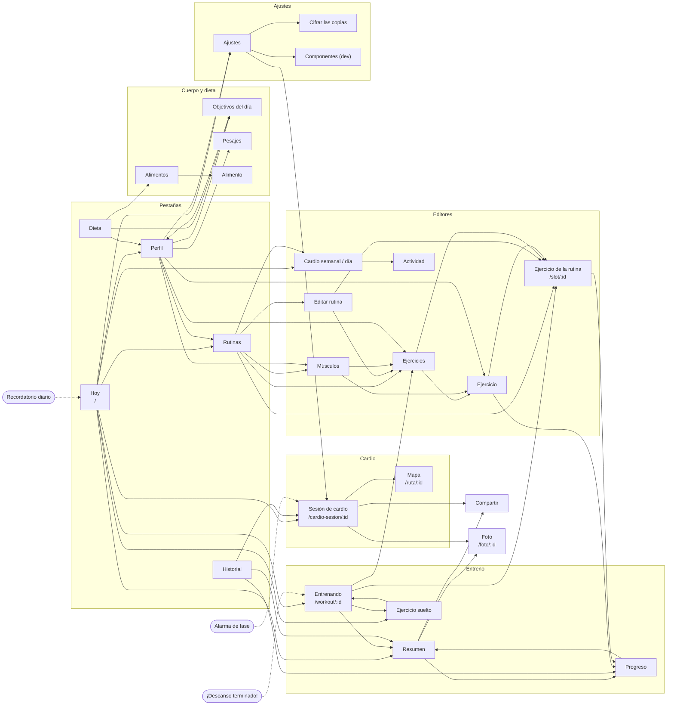

### 3.2 Entreno

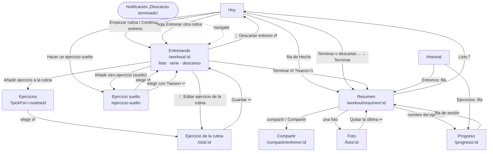

### 3.3 Cardio

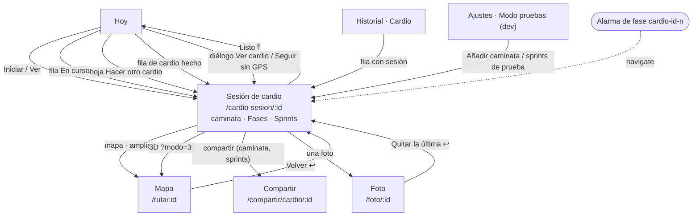

### 3.4 Rutinas, ejercicios y cardio semanal

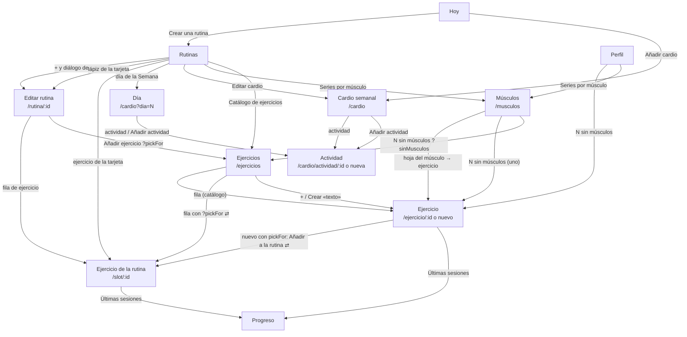

### 3.5 Perfil, dieta y ajustes

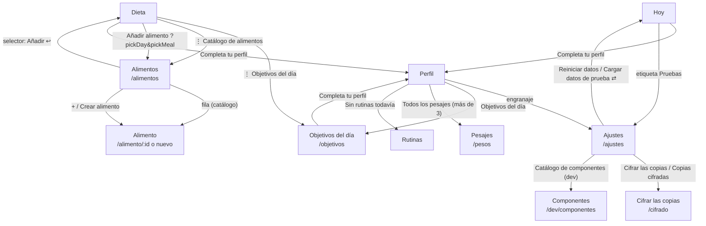

### 3.6 Entradas externas

| Origen | Identificador | Qué abre | Cómo |
|---|---|---|---|
| Fin del descanso | `rest-<sesión>` | `/workout/:sessionId` (si ya terminó, redirige al resumen) | `data.url` → `router.navigate` en [_layout.tsx](src/app/_layout.tsx) |
| Cambio de fase / fin de Fases | `cardio-<sesión>-<n>`, `cardio-<sesión>-end` | `/cardio-sesion/:id` | ídem |
| Recordatorio diario | `daily-1` … `daily-7` | `/` | ídem |
| «Entreno en curso», cuenta atrás, burbuja (módulo nativo) | notificación 7341 | La app donde estaba (intent de lanzamiento, sin ruta) | `PendingIntent` del servicio |
| «Grabando la ruta» / «Sprints» (expo-location) | servicio en primer plano | La app donde estaba | expo-location |
| Alarma de respaldo del pitido | `AlarmClockInfo` | La app (intent de lanzamiento) | `SprintBeep.showIntent` |
| Deep link | `entreno://<ruta>` | Cualquier ruta de §2.1 | expo-router |

Con la app cerrada, el toque se recoge al arrancar con `getLastNotificationResponseAsync()` y luego se limpia.

### 3.7 Rarezas y puntos a revisar

- **Resuelto en la 1.4.1: volver a Hoy con `router.replace('/')`.** Desde una pantalla apilada («Listo» del resumen y del cardio, descartar, reiniciar datos) creaba otra copia de las pestañas: comprobado en el emulador, tras «Listo» hacían falta dos «Atrás» para salir de la app. Ahora es `router.dismissTo('/')`, que cierra lo apilado y vuelve a la Hoy que ya existe: un «Atrás» sale.
- Las notificaciones del módulo nativo y del GPS no llevan ruta: abren la app en la pantalla que tuviera (tras un arranque en frío, Hoy).
- `/pesos` solo es accesible con más de 3 pesajes; `/dev/componentes` está registrada también en release pero redirige a `/`.
- `useSaveGuard` cae en `replace('/rutinas')` sin historial, también en editores a los que se llega desde Perfil o Músculos (solo pasa con un deep link).
- A las pestañas se llega con `router.push` (Hoy, Dieta) o con `router.navigate` (Objetivos, «Esta semana», «Ir a Hoy»); funcionan igual, pero no es uniforme.
- [cardio.tsx](src/app/cardio.tsx) convierte con `as Href` el enlace a `/cardio/actividad/…` «hasta que se regeneren las rutas tipadas»: el cast ya no hace falta.
- En Hoy, los ejercicios de una `RoutineCard` no abren su editor (en Rutinas sí).
- [alimentos.tsx](src/app/alimentos.tsx) tiene su propio `SearchField` local en lugar de [SearchField.tsx](src/components/SearchField.tsx).

---

## 4. Base de datos

### 4.1 Convenciones

- SQLite con SQLCipher, fichero `entreno.db` en `Documents/SQLite/`. Al abrir: `PRAGMA key`, `journal_mode = WAL`, `foreign_keys = ON`.
- Ids `INTEGER PRIMARY KEY AUTOINCREMENT`; pesos en kg (`REAL`); fechas locales `TEXT 'YYYY-MM-DD'`; instantes en epoch ms (`INTEGER`); booleanos `INTEGER 0/1`; día de la semana ISO 1–7; borrado lógico con `archived = 1` (en la interfaz siempre «Borrar» o «Quitar»).
- `profile` y `settings` tienen una sola fila (`id = 1`, con `CHECK`).
- Repositorios contra la interfaz mínima `Db` ([db.ts](src/db/db.ts)): en Jest se usa `node:sqlite` en memoria (`src/db/__tests__/testDb.ts`).

### 4.2 Diagrama

```mermaid
erDiagram
  routine ||--o{ routine_weekday : "días"
  routine ||--o{ routine_slot : "ejercicios"
  exercise ||--o{ routine_slot : "es"
  exercise ||--o{ exercise_muscle : "músculos"
  routine |o--o{ workout_session : "rutina (NULL = suelta)"
  workout_session ||--o{ set_log : "series"
  routine_slot |o--o{ set_log : "slot"
  exercise ||--o{ set_log : "ejercicio"
  routine_slot ||--o{ weight_change : "sugerencias"
  workout_session |o--o{ weight_change : "origen"
  cardio_activity |o--o{ cardio_session : "actividad"
  cardio_activity |o--o{ cardio_log : "actividad"
  cardio_session |o--o{ cardio_log : "resultado"
  cardio_session ||--o{ cardio_point : "puntos GPS"
  cardio_session |o--o{ photo : "fotos"
  workout_session |o--o{ photo : "fotos"
  food ||--o{ diet_item : "alimento"

  profile {
    INTEGER id PK "siempre 1"
    TEXT name
    TEXT sex "male o female"
    TEXT birth_date
    REAL height_cm
    REAL activity_factor
    REAL deficit_kcal "negativo = superávit"
    REAL protein_g_per_kg
    REAL fat_g_per_kg
    REAL water_l_per_kg
  }
  settings {
    INTEGER id PK "siempre 1"
    INTEGER rest_seconds_default
    REAL default_increment_kg
    TEXT progression_mode "average o strict"
    INTEGER sessions_below_to_decrease
    INTEGER daily_reminder_enabled
    TEXT daily_reminder_time "HH:mm"
    INTEGER keep_awake
    INTEGER rest_overlay
    INTEGER dev_mode
    TEXT backup_owner
    TEXT backup_repo
    TEXT backup_path
    INTEGER last_backup_at
    TEXT last_backup_error
    TEXT cardio_hero
    TEXT distance_unit "km o m"
    TEXT cardio_chart "pace speed altitude"
    TEXT cardio_live_panel "map chart splits"
  }
  app_meta {
    TEXT key PK
    TEXT value
  }
  weight_log {
    INTEGER id PK
    TEXT date UK
    REAL weight_kg
  }
  exercise {
    INTEGER id PK
    TEXT name UK
    TEXT type "external o bodyweight"
    TEXT equipment
    REAL increment_kg
    TEXT notes
    INTEGER archived
    INTEGER pair "dos mancuernas"
  }
  exercise_muscle {
    INTEGER exercise_id PK, FK
    TEXT muscle PK "clave de MUSCLE_KEYS"
    TEXT role "primary o secondary"
  }
  routine {
    INTEGER id PK
    TEXT name
    INTEGER position
    INTEGER archived
  }
  routine_weekday {
    INTEGER routine_id PK, FK
    INTEGER weekday PK "ISO 1-7"
  }
  routine_slot {
    INTEGER id PK
    INTEGER routine_id FK
    INTEGER exercise_id FK
    INTEGER position
    REAL weight_kg "NULL = peso corporal"
    INTEGER sets
    TEXT target_kind "range fixed failure"
    INTEGER rep_min
    INTEGER rep_max
    INTEGER fixed_reps
    INTEGER failure_minus
    INTEGER per_side
    TEXT unit "reps steps seconds"
    TEXT progression "load o manual"
    INTEGER allow_decrease
    REAL increment_kg
    INTEGER rest_seconds
    TEXT note
    INTEGER archived
  }
  workout_session {
    INTEGER id PK
    INTEGER routine_id FK "NULL = suelta"
    TEXT date
    INTEGER started_at
    INTEGER finished_at
    TEXT status "in_progress o finished"
    INTEGER imported
    TEXT notes
    INTEGER rest_ends_at
    TEXT rest_notification_id
    INTEGER current_slot_id "sin FK"
    TEXT skipped_slot_ids "JSON"
    TEXT title
  }
  set_log {
    INTEGER id PK
    INTEGER session_id FK "ON DELETE CASCADE"
    INTEGER slot_id FK
    INTEGER exercise_id FK
    INTEGER set_index
    REAL weight_kg "copia del slot"
    INTEGER reps
    INTEGER is_extra
    INTEGER completed_at
    INTEGER is_warmup
  }
  weight_change {
    INTEGER id PK
    INTEGER slot_id FK
    INTEGER session_id FK "ON DELETE SET NULL"
    REAL from_kg
    REAL to_kg
    TEXT reason
    TEXT source "progression manual import"
    TEXT status "pending applied dismissed expired"
    INTEGER created_at
    INTEGER decided_at
  }
  cardio_activity {
    INTEGER id PK
    INTEGER weekday
    TEXT name
    TEXT target
    TEXT intensity
    TEXT notes
    INTEGER position
    INTEGER archived
    TEXT tracking "check gps timer sprint"
    TEXT plan "JSON"
  }
  cardio_log {
    INTEGER id PK
    TEXT date "UNIQUE con activity_id"
    INTEGER activity_id FK
    TEXT name
    INTEGER done
    TEXT value
    TEXT notes
    INTEGER session_id FK
  }
  cardio_session {
    INTEGER id PK
    INTEGER activity_id FK
    TEXT name
    TEXT date
    TEXT tracking "gps timer sprint"
    TEXT status "in_progress o finished"
    INTEGER started_at
    INTEGER finished_at
    INTEGER paused_at
    INTEGER paused_ms
    INTEGER segment
    TEXT plan "JSON"
    REAL distance_m
    TEXT route "polilínea"
    TEXT samples "JSON"
    TEXT title
    TEXT laps "JSON"
    TEXT lap_fixes "JSON"
  }
  cardio_point {
    INTEGER id PK
    INTEGER session_id FK "ON DELETE CASCADE"
    INTEGER segment
    INTEGER t
    REAL lat
    REAL lon
    REAL accuracy
    REAL speed
    REAL altitude
    INTEGER received_at
  }
  photo {
    INTEGER id PK
    INTEGER cardio_session_id FK "ON DELETE CASCADE"
    INTEGER workout_session_id FK "ON DELETE CASCADE"
    TEXT file "en Documents/photos"
    INTEGER width
    INTEGER height
    INTEGER taken_at
    REAL lat
    REAL lon
    INTEGER created_at
  }
  food {
    INTEGER id PK
    TEXT name UK
    REAL fat_per_100g
    REAL carbs_per_100g
    REAL protein_per_100g
    INTEGER archived
  }
  diet_item {
    INTEGER id PK
    INTEGER weekday
    TEXT meal "desayuno comida merienda cena"
    INTEGER food_id FK
    REAL grams
    INTEGER position
  }
```

### 4.3 Qué guarda cada tabla

| Tabla | Qué guarda | Notas |
|---|---|---|
| `profile` | Datos del cuerpo y de los objetivos | El peso no va aquí: es el último de `weight_log`. Los g/kg de proteína y grasa y los L/kg de agua se editan en Objetivos del día (el agua en ml/kg). `name` no se usa. |
| `settings` | Ajustes de la app y estado de la copia | `progression_mode`, `sessions_below_to_decrease` y `default_increment_kg` se editan en Ajustes → «Sugerencias de peso» y `getSettings` los limpia (`sanitizeProgression`). `cardio_*` y `distance_unit` recuerdan la vista de la caminata. |
| `app_meta` | Datos internos que sobreviven a un reinicio de datos | `install-stamp` (modo pruebas), `hint:<pista>` (pistas de un solo uso), `admin` (opciones de administrador) y `photo-pending` (la foto mientras la cámara o la galería están abiertas). No va en la copia. |
| `weight_log` | Un pesaje por día | `logWeight` hace *upsert* por fecha. |
| `exercise` | Catálogo de ejercicios | `pair = 1`: el peso es de cada mancuerna y el volumen cuenta las dos. Crear uno con el nombre de un archivado lo recupera. |
| `exercise_muscle` | Músculos principales y secundarios de cada ejercicio | Un músculo es principal o secundario, no ambos. Claves desconocidas se ignoran al leer. |
| `routine` / `routine_weekday` | Rutinas y en qué días tocan | Archivar una rutina borra sus días. Dos rutinas archivadas guardan fichas que no son de ninguna rutina: «Ejercicios sueltos» (`LOOSE_ROUTINE`, las de los ejercicios sueltos que no están en ninguna, 1.4.6) y, en los datos del usuario, «Notas antiguas» (las sesiones importadas de sus notas, manuales y al fallo). Nada las muestra. |
| `routine_slot` | Un ejercicio dentro de una rutina con su prescripción | **El peso actual vive aquí**; solo cambia al aplicar una sugerencia o a mano. |
| `workout_session` | Un entreno | `routine_id` NULL = sesión suelta (sus ejercicios salen de `set_log.slot_id` y `current_slot_id`). `rest_ends_at`, `current_slot_id` y `skipped_slot_ids` guardan el estado en curso. `imported` = vino del Excel. Descartar **borra** la fila (el estado `abandoned` existe en el tipo pero no se escribe). |
| `set_log` | Cada serie | `weight_kg` copia el peso del slot al registrar (el historial no cambia si el slot sube). `is_warmup = 1` = aproximación: no cuenta para series, volumen, récords ni progresión. |
| `weight_change` | Sugerencias y cambios de peso | Abiertas = `pending` + `dismissed`. Como mucho una abierta por slot. |
| `cardio_activity` | Cardio de la semana, por día | `plan`: JSON de Fases (`liss`/`miss`/`hiit`) o de sprints (`{kind:'sprint', sprints, restSec}`). |
| `cardio_log` | Cardio hecho un día | `UNIQUE(date, activity_id)`; desmarcar pone `done = 0`. Con `session_id` si se grabó. |
| `cardio_session` | Una sesión grabada | `route` (polilínea) y `samples` (`[[s, d, a], …]`) al terminar; `laps` es todo el estado de los sprints; `lap_fixes`, sus puntos GPS para recalcular. |
| `cardio_point` | Puntos GPS de la sesión en curso | Se borran al terminar. No van en la copia. |
| `photo` | Fotos de una sesión de cardio o de un entreno (exactamente uno, con `CHECK`) | `file` es el nombre de su copia reducida en `Documents/photos/`; la fila va en la copia, la imagen no. `taken_at` y `lat`/`lon` (su sitio en la ruta) cuando se saben. Borrar la sesión borra las filas (también en el repositorio, sin depender de `foreign_keys`) y la pantalla borra los ficheros (`deletingPhotosOf`). |
| `food` / `diet_item` | Alimentos (macros por 100 g) y plan semanal | Borrar un alimento lo archiva: sigue en los días que lo usan. |

Índices: `set_log(session_id)`, `set_log(slot_id, completed_at)`, `set_log(exercise_id, completed_at)`, `workout_session(status)`, `workout_session(date)`, `weight_change(slot_id, status)`, `diet_item(weekday)`, `cardio_log(date)`, `cardio_point(session_id, t)`, `cardio_session(status)`, `photo(cardio_session_id)`, `photo(workout_session_id)`.

### 4.4 Migraciones

[migrations.ts](src/db/migrations.ts): lista que solo crece; cada una corre en su transacción y deja `user_version = índice + 1`. **Nunca se edita una publicada.**

| # | Versión | Qué hace |
|---|---|---|
| 1 | 1.0.0 | Esquema inicial: `profile`, `settings`, `weight_log`, `exercise`, `routine`, `routine_weekday`, `routine_slot`, `cardio_activity`, `cardio_log`, `workout_session`, `set_log`, `weight_change`, `food`, `diet_item` e índices |
| 2 | 1.0.0 | `settings.rest_overlay` (burbuja) |
| 3 | 1.0.0 | `settings.dev_mode` (`DEFAULT 1`), `settings.last_backup_error`, tabla `app_meta` |
| 4 | 1.1.0 | `cardio_activity.tracking` y `plan`; tablas `cardio_session` y `cardio_point`; `cardio_log.session_id`; `CARDIO_TRACKING_DEFAULTS` (caminar → GPS; HIIT y bici → Fases) |
| 5 | 1.3.0 | `set_log.is_warmup`, `workout_session.title`, `cardio_session.title`, `settings.cardio_hero`, `distance_unit`, `cardio_chart`, `cardio_live_panel` |
| 6 | 1.3.0 | Solo datos: tildes en 9 alimentos del catálogo (`FOOD_NAME_FIXES`) |
| 7 | 1.3.3 | `exercise.pair` y `EXERCISE_PAIR_DEFAULTS` (material «mancuernas») |
| 8 | 1.3.4 | `cardio_session.laps` y `lap_fixes`, `cardio_point.received_at`; `SPRINT_TRACKING_DEFAULTS` (Fases HIIT con «sprint» en el nombre → Sprints 6 × 1:30) |
| 9 | 1.4.0 | Tabla `exercise_muscle` y `EXERCISE_MUSCLE_DEFAULTS` (los 22 del catálogo, por nombre, sin tocar los que ya tengan) |
| 10 | 1.4.3 | Tabla `photo` y sus dos índices |

### 4.5 Cifrado de la base (SQLCipher)

[secureDatabase.ts](src/services/secureDatabase.ts), antes de abrir la BD (`prepareDatabase`, una vez por proceso):

1. Lee la clave de `expo-secure-store` (`database-key`): 256 bits aleatorios creados en el móvil; nunca sale de él.
2. Sin clave → la crea. Sin fichero → BD nueva cifrada.
3. Fichero en claro (empieza por `SQLite format 3`) → `ATTACH … KEY` + `sqlcipher_export` a `entreno-cifrada.db`, copia `user_version`, comprueba que abre y tiene las mismas filas de `set_log`, y la pone en su sitio. Si falla, sigue con la de siempre (`key = null`) y lo reintenta en el próximo arranque.
4. Fichero cifrado sin su clave en el móvil → lo aparta como `entreno-ilegible-<ms>.db` y empieza vacía (hay que restaurar una copia).
5. Se abre con `PRAGMA key = "x'…'"` (clave en bruto) como primera sentencia de `onInit`. La tarea GPS abre su propia conexión con la misma clave (`openDatabaseInBackground`).

`android.allowBackup: false`: ni la BD ni el almacén seguro van a la copia de Google.

### 4.6 Almacén seguro (Keystore)

| Clave | Qué guarda | Lo escribe |
|---|---|---|
| `database-key` | Clave hex de SQLCipher | `secureDatabase.ts` |
| `backup-key` | Clave derivada de la contraseña de las copias y su KDF (`{kdf, key}`) | `backupCipher.ts` / `backup.ts` |
| `github-backup-token` | Token *fine-grained* de GitHub | `backup.ts` (`githubToken`) |

Además, el módulo nativo usa `SharedPreferences`: posición de la burbuja (`rest_timer_overlay`) y latencia aprendida del pitido (`sprint-beep`).

### 4.7 Copia de seguridad: qué entra y cómo se restaura

- **Entra** (`BACKUP_TABLES`, en orden de claves ajenas): `profile`, `settings`, `weight_log`, `exercise`, `exercise_muscle`, `routine`, `routine_weekday`, `routine_slot`, `cardio_activity`, `cardio_session`, `cardio_log`, `workout_session`, `set_log`, `photo`, `weight_change`, `food`, `diet_item`.
- **No entra**: `cardio_point` (puntos de una caminata en curso), `app_meta`, las imágenes de las fotos (`Documents/photos/`: solo sus filas), todo el almacén seguro (clave de la BD, clave de las copias, token) y las `SharedPreferences` nativas.
- **Fotos**: borrar los datos (modo pruebas, restaurar) no borra las imágenes, así que restaurar la copia en el mismo móvil las recupera. En otro móvil las filas llegan sin imagen y no se muestran (`isOnPhone`). Las imágenes que ya no tiene ninguna fila (fotos de pruebas) se quedan en la carpeta.
- **Formato**: `{ app: 'entreno', schemaVersion, exportedAt, tables }`. Cifrada: `{ app, format: 'entreno-cifrada-1', kdf: { name: 'pbkdf2-sha256', iterations, salt }, cipher: 'AES-256-GCM', data }` (`data` = base64 de IV · texto cifrado · etiqueta).
- **Restaurar** (`restoreBackup` en [maintenance.ts](src/db/maintenance.ts)): rechaza un `schemaVersion` mayor que el de la app; borra e inserta todo en **una transacción**; ignora columnas desconocidas; las que faltan toman su valor por defecto. Como las migraciones no corren sobre filas restauradas, aplica los arreglos de datos según la versión de la copia:

| Copia anterior a | Se aplica |
|---|---|
| 4 | `CARDIO_TRACKING_DEFAULTS` |
| 6 | `FOOD_NAME_FIXES` |
| 7 | `EXERCISE_PAIR_DEFAULTS` |
| 8 | `SPRINT_TRACKING_DEFAULTS` |
| 9 | `EXERCISE_MUSCLE_DEFAULTS` |

  Siempre deja `dev_mode = 0`. Después (`restoreFrom`): adopta la clave de la copia si el móvil no tenía contraseña, `resetNotifications()` y `rescheduleDailyReminders()`.

### 4.8 Datos iniciales

- **Instalación nueva** (`SEED`, [seedData.ts](src/db/seedData.ts)): perfil vacío con valores por defecto, ajustes por defecto (descanso 150 s, incremento 2,5 kg, modo `average`, recordatorio **apagado** a las 07:00), y el catálogo de [catalog.json](data/seed/catalog.json) (22 ejercicios con sus músculos y los alimentos). Sin rutinas, cardio ni dieta.
- **Datos de prueba** (`DEMO_SEED`, [demoSeed.ts](src/db/demoSeed.ts) → [seed.json](data/seed/seed.json)): el Excel completo, con historial importado y sugerencias pendientes. Solo en tests y en builds de desarrollo.
- `importSeed` solo actúa si no hay fila en `profile`, en una transacción.

---

## 5. Flujos principales

### 5.1 Entrenar una rutina

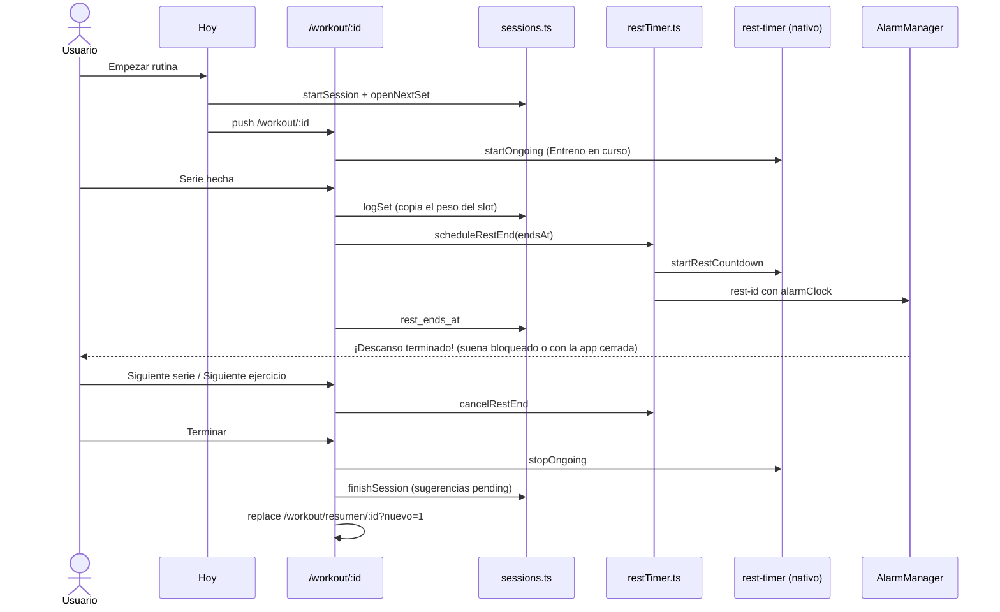

1. **Empezar** (Hoy, `start`): si hay otro entreno activo → diálogo «Hay un entreno en curso»; si hay sprints o Fases en curso (`sharesLockCountdown`) → diálogo; si no, `startSession` (fila `in_progress`) → `openNextSet` (`current_slot_id` = `slotToOpen`) → `/workout/:id`.
2. **Pantalla**: carga sesión, series, slots (`sessionSlots`), reps y aproximaciones de la última vez, ajustes y sugerencias abiertas. Cada recarga llama a `showWorkoutInProgress` (notificación fija). Pantalla encendida si `keep_awake`.
3. **Serie** (`SetView`): stepper de reps precargado; «Serie hecha» → `logSet` + háptico → `nextStep`. Si era la última de todo, sin descanso: `current_slot_id = NULL` y la lista muestra «Rutina completada». Si no, `scheduleRestEnd` y `rest_ends_at` + `rest_notification_id`.
   - Antes de la primera serie, sugerencia pendiente como botón ancho (`applyChange` / `undoChange`); después, línea discreta.
   - «+ Aproximación» → `logWarmupSet` (no inicia descanso). Toda la fila del peso → «Cambiar peso» → `setSlotWeightManually` (cambio `manual`, expira sugerencias).
   - Corregir/borrar series hechas (`updateSetReps`, `deleteSet` → Snackbar → `restoreSet`); serie extra si se pasa de `sets`.
   - ⋮: «Saltar ejercicio» (`skipped_slot_ids`, con «Deshacer»), «Añadir aproximación», «Editar ejercicio de la rutina».
4. **Descanso** (`RestView`): anillo calculado siempre como `endsAt − ahora`; «−30 s»/«+30 s» → `shiftDeadline` y reprogramar; «Saltar descanso» o, a 0, «Siguiente serie» / «Siguiente ejercicio» / «Empezar ejercicio» / «Terminar» → `cancelRestEnd`. Corregir la última serie no toca la alarma. Si la burbuja está activada sin permiso, aviso «Dar permiso».
5. **Atrás** desde serie o descanso → lista; durante el descanso la lista muestra la mini barra y elegir un ejercicio lo pone como siguiente sin cortar la cuenta atrás.
6. **Terminar** (con «¿Terminar ya?» si quedan ejercicios): `clearWorkoutInProgress` → `cancelRestEnd` → `finishSession` (en una transacción: `finished` + por cada slot con series de trabajo, `recommend()` → `weight_change` `pending`, o expira la abierta si sale «mantener») → ⇄ resumen → `maybeAutoBackup`.
7. **Resumen**: «Subir a…» (`applyChange`, cambia `routine_slot.weight_kg`) o «Mantener…» (`dismissChange`, queda como sugerencia discreta); «Aplicar las N». ⋮ «Corregir series» → `refreshRecommendations`; «Borrar entreno» → `deleteFinishedSession` (expira sus sugerencias).
8. **Descartar** (⋮ de la lista) → `discardSession` (borra sesión y series) → ⤒.

**Si se mata la app**: sesión, series y `rest_ends_at` están en la BD y la alarma `rest-<id>` sigue en `AlarmManager` (suena). La cuenta atrás nativa y la burbuja mueren con el proceso. Al arrancar, `restoreWorkoutInProgress` vuelve a poner «Entreno en curso»; Hoy ofrece «Continuar entreno» → `openNextSet` → la serie o el descanso con el tiempo que quede. La cuenta atrás de la pantalla de bloqueo no vuelve hasta el siguiente descanso (nadie vuelve a llamar a `startRestCountdown`). Con más de 12 h, Hoy ofrece «Terminar o descartar…».

### 5.2 Ejercicio suelto

1. Hoy → «Hacer un ejercicio suelto» (solo sin entreno activo y con algún slot; con sprints o Fases en curso, diálogo) → `/ejercicio-suelto`: una sección por rutina, buscador por nombre o músculo (`matchesExercise`).
2. Elegir → `startLooseSession` (transacción; `routine_id = NULL`, `current_slot_id` = slot; devuelve `null` si ya hay otro entreno → diálogo «Ver entreno») → ⇄ `/workout/:id`.
3. Se entrena con el slot prestado (su peso, prescripción, descanso, nota y sugerencia). Título «Ejercicio suelto»; sin «Saltar ejercicio»; «Cambiar peso» avisa «también en «<rutina>»».
4. Lista → «Añadir otro ejercicio» (fuera del descanso) → `/ejercicio-suelto?sesion=:id` (sin los ya presentes, `looseSlotIds`) → `addLooseExercise` → ↩.
5. Atrás desde un ejercicio sin ninguna serie en la sesión → `discardSession` y sale. Terminar una sesión sin series → `discarded` → ⤒.
6. `finishSession` usa `expireOnKeep = false`: un «mantener» de unas series sueltas no borra la sugerencia abierta de la rutina.
7. Se nombra como el primer ejercicio («Remo con barra (90º) y 1 más», `workoutTitle`); en el Historial lleva «Suelto».

### 5.3 Descanso en segundo plano y «Entreno en curso»

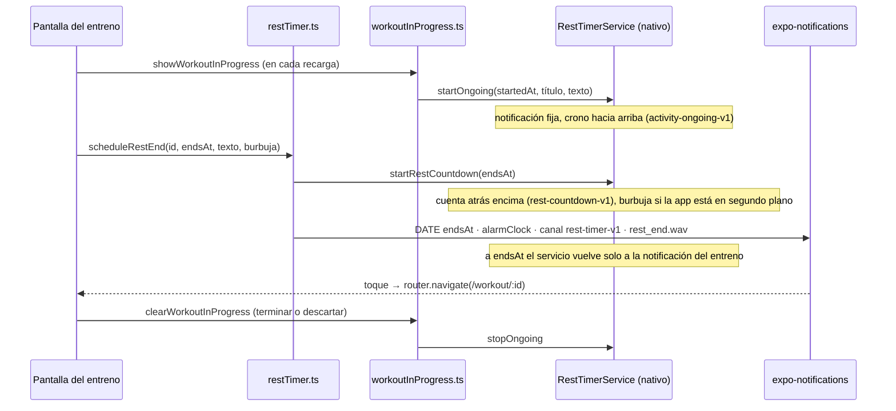

- **Alarma**: `scheduleRestEnd` cancela la anterior y programa `rest-<sesión>` con `delivery: 'alarmClock'` (→ `AlarmManager.setAlarmClock`, exenta de Doze), sonido `rest_end.wav`, vibración y `data.url`. Con la app delante, el handler la muestra y suena igual; además la pantalla vibra al llegar a 0.
- **Cuenta atrás visible**: `RestTimerService` es un servicio en primer plano (`specialUse`) con una sola notificación (id 7341): cuenta atrás con `setChronometerCountDown`, `setTimeoutAfter`, pública en bloqueo, coloreada o *Live Update* en Android 16. Al llegar a 0 o con `stop`, vuelve a la del entreno (o se para si no hay entreno).
- **Burbuja**: si el ajuste está activo y hay permiso «Mostrar sobre otras apps», la muestra solo con la app en segundo plano (`OnActivityEntersBackground`); arrastrable, recuerda la posición, tocarla abre la app.
- **«Entreno en curso»**: título de la sesión o de la rutina, texto `inProgressText` («Serie 2 de 3 · Remo con barra · 37,5 kg» o «4 de 19 series») y tiempo desde el inicio. La quitan terminar, descartar, `resetNotifications` (reiniciar o restaurar datos).

### 5.4 Caminata con GPS

1. Hoy → «Iniciar» → `startCardio` ([cardioSession.ts](src/services/cardioSession.ts)): `startCardioSession` (fila `in_progress`) → `startGpsTracking(WALK_GPS)`: permiso de ubicación **en primer plano** y precisa, ubicación activada (si no, `enableNetworkProviderAsync`), `startLocationUpdatesAsync('entreno-gps')` cada 3 s con `BestForNavigation` y servicio en primer plano «Grabando la ruta» (`killServiceOnDestroy: false`). Si falla, descarta la sesión y muestra el motivo (`GPS_ERROR_MESSAGE`).
2. La tarea `entreno-gps` (definida al cargar [gpsTracker.ts](src/services/gpsTracker.ts)) abre su conexión cifrada y guarda los puntos con `addTrackPoints` en la sesión GPS o de sprints en marcha (sin pausa), con su `segment` y `received_at`.
3. Pantalla en directo: `useCardioSession` relee cada 3 s; píldora del GPS como título; panel de cifras (`MetricBoard`); segmentado Mapa · Gráfica · Parciales (se recuerda en `settings.cardio_live_panel`); tocar el mapa → `/ruta/:id`.
4. «Pausar» → para el GPS y `paused_at`; «Seguir» → `paused_ms` += pausa, `segment + 1`, GPS otra vez (la distancia nunca une tramos).
5. «Terminar» → «¿Terminar y guardar?» → `finishCardioSession`: `summarizeTrack`, `encodeRoute` → `route`, `buildSamples` → `samples`, borra `cardio_point`, *upsert* en `cardio_log` con el resultado («5,2 km · 58 min») y `session_id` → detalle con «Compartir» y «Listo» → `maybeAutoBackup`.
6. ⋮ «Descartar caminata» / «Borrar caminata» → `discardCardio` → `deletingPhotosOf` + `discardCardioSession` (puntos, registro del día, fotos y sesión; después los ficheros de las fotos).
7. Cámara de la cabecera (en directo) → `placeFromFix` con el último punto (≤ 30 s y ±50 m) → `takePhoto`: la foto se queda en ese punto del mapa (§5.14).

**Si se mata la app**: el servicio de expo-location sigue y Android arranca un contexto JS solo para la tarea, que sigue guardando puntos. Al abrir la pantalla, `ensureCardioRunning` vuelve a arrancar el GPS si se paró (p. ej. tras reiniciar el móvil). Hoy muestra la fila «En curso».

### 5.5 Fases (temporizador)

1. «Iniciar» → `startCardioSession` copia el plan → `scheduleCardioTimer` ([cardioTimer.ts](src/services/cardioTimer.ts)): cuenta atrás nativa hasta el final del plan y **todas** las alarmas a la vez (`cardio-<sesión>-<n>` por cambio de fase y `cardio-<sesión>-end`), con `alarmClock`, canal `rest-timer-v1` y `data.url`.
2. Pantalla: fase actual, lo que queda, la siguiente y la barra de fases coloreada por intensidad; pantalla encendida si `keep_awake`.
3. «Pausar» → `cancelCardioTimer` (cancela las pendientes, retira las mostradas salvo la final, para la cuenta atrás) y `paused_at`; «Seguir» → reprograma lo que falte.
4. Al acabar el plan con la pantalla abierta, termina sola 3 s después con la hora real del final; «Terminar» lo hace a mano. `finishCardioSession` deja «30 min» en `cardio_log`.
5. No puede ir a la vez que un entreno (comparten la cuenta atrás de bloqueo).

**Si se mata la app**: las alarmas siguen en `AlarmManager` y suenan; la cuenta atrás muere con el proceso. Al abrir la pantalla, `ensureCardioRunning` reprograma alarmas y cuenta atrás. Al arrancar la app no se repone (solo los sprints).

### 5.6 Sprints

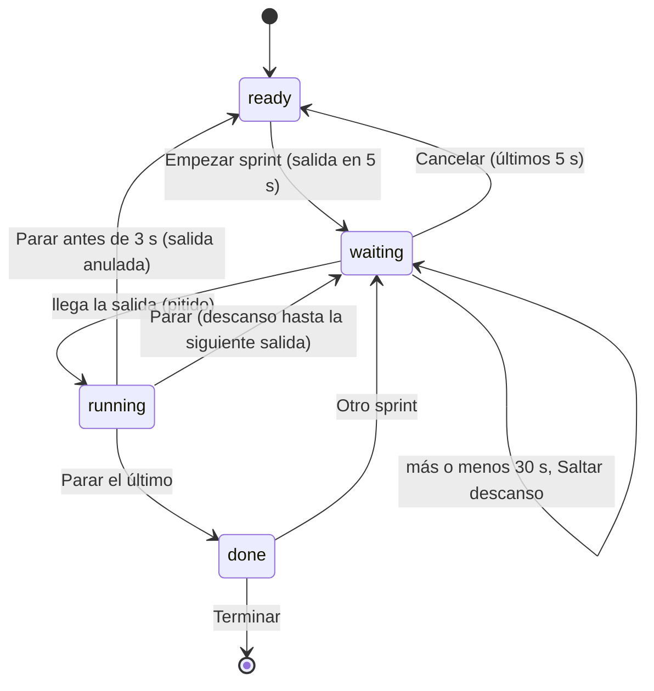

1. «Iniciar» → `startCardioSession` (plan de sprints, `laps = '[]'`) → GPS a 1 punto/s (`SPRINT_GPS`, notificación «Sprints») + `syncSprint`. Sin GPS, la sesión se queda y Hoy pregunta «Seguir sin GPS» (solo tiempo) o «Cancelar» (la descarta).
2. **Estado**: todo sale de `cardio_session.laps` y la hora (`sprintState` en [sprint.ts](src/domain/sprint.ts)): `ready`, `waiting` (descanso o cuenta atrás; los últimos 5 s vibra a 3, 2 y 1), `running` (más de 60 s → «¿Se te olvidó parar?» / «Quitar este sprint»), `done`.
3. **Acciones** ([sprintSession.ts](src/services/sprintSession.ts)): leen, aplican una transición pura y escriben con `setSprintLaps` (bloqueo optimista: un doble toque escribe una vez), y luego `syncSprint`. «Parar» toma la hora del toque; antes de 0,6 s se ignora; antes de 3 s, «Salida anulada» con «Deshacer». Tocar la última fila → ⋮ «Quitar el sprint N» (con «Deshacer»).
4. **`syncSprint`**: si hay una salida pendiente, `scheduleSprintBeep(goAt)` y cuenta atrás nativa («Descanso» o «Preparados»); si no, los cancela. Se llama tras cada acción, al volver la app a primer plano y al arrancar.
5. **Pantalla sobre el bloqueo**: mientras está enfocada, `setShowWhenLocked(true)` (botón de encendido → «Parar» sin PIN). Atrás no sale mientras corre o en la cuenta atrás.
6. **Terminar** (o ⋮ «Terminar ahora», con «¿Terminar con N de M sprints?») → `finishSprints`: cierra el sprint abierto, espera hasta 5 s a los puntos posteriores a la última parada, `stopSprintTracking` (pitido, GPS, cuenta atrás, pase de bloqueo), mide cada sprint (`measureLaps`) y `finishSprintSession` guarda `laps` medidos, `lap_fixes`, borra los puntos y escribe `cardio_log`.

**Si se mata la app**: la alarma de respaldo (2 s antes de la salida) levanta el proceso y el receptor toca el pitido; al arrancar, `restoreCardioInProgress` → `ensureCardioRunning` (sin pedir permisos) → GPS + `syncSprint`. El sprint sigue corriendo desde su salida.

### 5.7 Marcar cardio y «Hacer otro cardio»

- **Marcar** (círculo ✓ de Hoy): `setCardioDone(fecha, actividad, hecho)` → *upsert* en `cardio_log` (`UNIQUE(date, activity_id)`); desmarcar deja `done = 0`.
- **Para hoy / Hecho**: el cardio del día (`cardio_activity.weekday`) sin registro va arriba; el hecho baja a «Hecho», junto al de otros días hecho hoy (`doneOnOtherDays`).
- **Hacer otro cardio** (si no hay cardio en curso): hoja con `cardioPool` ([cardioPool.ts](src/domain/cardioPool.ts)): el cardio de otros días agrupado por `cardioKey` (nombre, objetivo e intensidad normalizados, cómo se registra y plan), sin los grupos que tocan hoy o ya están hechos hoy; lo representa la de menor id. Tocar: «Marcar» se marca; el resto se inicia como en Hoy, con las mismas exclusiones.
- Terminar una sesión grabada escribe su `cardio_log` con el resultado y `session_id`; borrarla borra también su registro.

### 5.8 Editar rutinas, slots, ejercicios y cardio

| Qué | Dónde | Escritura | Reprograma el recordatorio |
|---|---|---|---|
| Crear rutina | Rutinas «+» → diálogo | `createRoutine` | Sí |
| Renombrar, días, ordenar | `/rutina/:id` (al momento) | `renameRoutine`, `setRoutineWeekdays`, `moveSlot` | Sí |
| Borrar rutina | ⋮ de `/rutina/:id` | `archiveRoutine` (`archived = 1` y borra sus días) | Sí |
| Rutinas de un día | `/cardio?dia=N` (casillas) | `setRoutineOnWeekday` | Sí |
| Añadir ejercicio a una rutina | `/ejercicios?pickFor` | `addSlot` → ⇄ `/slot/:nuevo` | Sí |
| Prescripción y peso del slot | `/slot/:id` «Guardar» | `updateSlotPrescription` + `setSlotWeightManually` si cambió el peso | Sí |
| Quitar de la rutina | ⋮ de `/slot/:id` | `archiveSlot` | Sí |
| Ejercicio del catálogo | `/ejercicio/:id` «Guardar» | `createExercise`/`updateExercise`, `setExerciseMuscles` | Solo si se crea para una rutina |
| Borrar ejercicio | ⋮ de `/ejercicio/:id` | `archiveExercise` (las rutinas y el historial no cambian) | No |
| Actividad de cardio | `/cardio/actividad/:id` | `addCardio`/`updateCardio` (tipo y plan) | Sí |
| Quitar actividad | ⋮ de la actividad | `archiveCardio`; «Deshacer» → `unarchiveCardio` + `emitDataChanged` | Sí |

Todas pasan por `queueWrite`. Los formularios (slot, ejercicio, actividad, alimento) tienen un «Guardar» abajo deshabilitado sin cambios y preguntan al salir con cambios. El nombre de un ejercicio es único (sin distinguir mayúsculas); los músculos se eligen en una hoja con chips por grupo y uno no puede ser principal y secundario a la vez.

### 5.9 Dieta

1. Pestaña Dieta: día (`DayPicker`), segmentado Día · Media semanal y rejilla de totales frente a objetivos (`deviation`: verde ±5 %, ámbar ±10 %, rojo fuera). Objetivos con `loadNutritionTargets` (perfil + último peso); sin datos, «Completa tu perfil para ver objetivos».
2. Cuatro comidas; tocar un alimento → hoja de gramos (`updateDietItemGrams`) o «Quitar» (`removeDietItem`, «Deshacer» → `restoreDietItem`).
3. «Añadir alimento» → `/alimentos?pickDay&pickMeal` → hoja de gramos → `addDietItem` → ↩.
4. ⋮ «Copiar el <día> a…» → hoja de días → `copyDietDay` (reemplaza esos días) con «Deshacer» (`restoreDietDays`).
5. Catálogo: búsqueda sin tildes, grupos por inicial; editor con macros por 100 g (no pueden sumar más de 100 g), kcal calculadas, nombre único; borrar archiva.

### 5.10 Perfil, músculos de la semana y objetivos

- **Esta semana** (`loadMuscleWeek`): series de trabajo de entrenos terminados del lunes a hoy (sin aproximaciones ni series sin reps) y el plan (`plannedWeekSets`: series de cada slot activo × días de su rutina). Cada serie suma 1 a cada músculo principal y 0,5 a cada secundario. La silueta (`BodyMap`, del sexo del perfil) se pinta por niveles (`muscleLevel`: menos de 3, 6, 10, 10 o más). Ejercicios sin músculos → fila ámbar.
- **Músculos** (`/musculos`): barra por músculo frente al plan con la franja de 10 a 20; la hoja de un músculo lista los ejercicios que suman.
- **Peso**: `WeightSheet` → `logWeight` (uno por fecha) o `deleteWeight` (nunca el único) con «Deshacer»; la gráfica usa `LineChart`; `/pesos` pagina con `listWeightsPage`.
- **Mis datos**: fecha de nacimiento (calendario nativo), altura y sexo → `updateProfile` al momento.
- **Objetivos** (`/objetivos`): objetivo con signo en `deficit_kcal`, actividad (`activity_factor`) y proteína, grasa y agua por kilo → `updateProfile`; recalcula TMB, gasto, IMC, calorías y macros en la misma pantalla (`computeTargets`: hidratos ≥ 0 y `kcalOver`).

### 5.11 Recordatorio diario

- `rescheduleDailyReminders` ([dailyReminder.ts](src/services/dailyReminder.ts)) va en cola y es idempotente: cancela `daily-1` … `daily-7` y, si está activado, programa 7 avisos `WEEKLY` (día con `isoToExpoWeekday`, hora y minuto de `daily_reminder_time`) en el canal `daily-reminder-v1`, con el texto de `buildDailyMessage` (rutinas con su número de ejercicios y el cardio del día) y `data.url = '/'`.
- Se llama al arrancar, al cambiar el ajuste o la hora en Ajustes, tras cada edición de §5.8, al reiniciar datos y al restaurar una copia.
- No usa `alarmClock`: en algunas capas de fabricante puede llegar tarde (PLAN §15).

### 5.12 Copias: GitHub, exportar/importar y cifrado

| Acción | Dónde | Qué pasa |
|---|---|---|
| Exportar | Ajustes «Exportar copia» | `exportBackup` → JSON (cifrado si hay contraseña) en `cache/entreno-backup-AAAA-MM-DD.json` → menú de compartir |
| Importar | Ajustes «Importar copia» | Selector de ficheros → `openBackup` (pide contraseña si hace falta) → «¿Restaurar la copia?» → `restoreFrom` |
| Configurar GitHub | Ajustes «Copia automática en GitHub» / «Cambiar configuración» | Usuario, repositorio y fichero en `settings`; token en el almacén seguro; «Olvidar el token» |
| Subir | «Subir ahora» o automática | `backupToGithub`: `GET` para el `sha` y `PUT` con el fichero en base64 (un commit por copia); guarda `last_backup_at` o `last_backup_error` |
| Automática | Arranque, terminar un entreno (también desde Hoy), terminar un cardio | `maybeAutoBackup`: como mucho una cada 24 h, nunca en modo pruebas, en silencio si falla o no está configurada |
| Restaurar de GitHub | «Restaurar…» | `downloadFromGithub` (raw) → igual que importar |
| Poner contraseña | `/cifrado` | `setBackupPassword` → PBKDF2-HMAC-SHA256 nativo (600 000 iteraciones, sal de 16 B, mínimo 10 caracteres) → guarda la **clave derivada** (no la contraseña); si GitHub está configurado y no hay modo pruebas, sube una copia cifrada |
| Dejar de cifrar | ⋮ de `/cifrado` | Borra la clave guardada |
| Abrir una cifrada | Importar o restaurar | Usa la clave guardada si la sal y las iteraciones coinciden; si no, pide la contraseña («No es esa. Prueba otra vez.»); un móvil sin contraseña adopta la de la copia al restaurar |
| En el ordenador | — | `node scripts/decrypt-backup.mjs copia.json > fuera-del-repo.json` |

### 5.13 Modo pruebas y datos de prueba

- `settings.dev_mode` (apagado en instalaciones nuevas; restaurar una copia siempre lo apaga).
- **Al instalar un APK nuevo** (`resetIfNewInstallInDevMode`, dentro de `onInit`): compara `Application.getLastUpdateTimeAsync()` con `app_meta('install-stamp')`; si cambió y `dev_mode = 1`, `resetData(SEED)` y `resetNotifications()`. `resetData` conserva `backup_owner`, `backup_repo`, `backup_path`, `last_backup_at` y `dev_mode` (para no subir datos vacíos encima de la copia buena).
- **Efectos**: etiqueta «Pruebas» en Hoy; sin copias automáticas; poner contraseña no sube copia.
- **Ajustes · Modo pruebas**: interruptor «Borrar los datos al instalar una versión nueva» y «Reiniciar datos ahora» (`resetToSeed` → ⤒). Solo en desarrollo (`__DEV__`, el bundle de release no los incluye): «Cargar datos de prueba (Excel)» (`DEMO_SEED`), «Añadir caminata de prueba» ([demoWalk.ts](src/db/demoWalk.ts)), «Añadir sprints de prueba» ([demoSprints.ts](src/db/demoSprints.ts)) y «Catálogo de componentes».
- Borrar los datos no borra las imágenes de las fotos (§4.7).

### 5.14 Fotos de las sesiones

| Acción | Dónde | Qué pasa |
|---|---|---|
| Hacer una foto | Cámara de la cabecera de la caminata en directo; «Añadir foto» → «Hacer una foto» en el detalle de cardio y en el Resumen | `takePhoto` ([photos.ts](src/services/photos.ts)): permiso de cámara → cámara del sistema (`launchCameraAsync`) → copia reducida → `addPhoto` con `taken_at` = ahora y el sitio (solo en directo) → el original va también a la galería (`Asset.create`). Sin permiso, Snackbar con «Ajustes». |
| Elegir de la galería | «Añadir foto» → «Elegir de la galería» | `pickPhotos`: selector de fotos del sistema (hasta 10, sin permiso de lectura), `exifTakenAt` y `exifPlace` del EXIF; en una caminata `photoPlace` decide su sitio: su GPS si está a menos de 200 m de la ruta, o la hora si la caminata no tuvo pausas (`placeAtTime`). |
| Copia reducida | `keep` | `ImageManipulator.manipulate(uri, { maxWidth: 2160, maxHeight: 2160 })` (Glide aplica la orientación del EXIF) → JPEG 0,85 → `Documents/photos/<ms>-<azar>.jpg`. |
| Ver | Tira de fotos → `/foto/:id` | Una por página, de la misma sesión, con la fecha y «En el mapa de la ruta» si tiene sitio. Las que tienen sitio salen como una cámara en el mapa del detalle y del directo (`RouteMap`). |
| Quitar | ⋮ de `/foto/:id` | `removePhoto`: borra la fila y el fichero (el original de la galería sigue allí). |
| Compartir | `/compartir/…` | Estilo «Foto»: la foto llena la imagen (`cover`) con un degradado arriba y abajo, y textos blancos con sombra; en una caminata, la ruta en blanco en el mismo sitio que en Oscuro. La captura espera a que cargue la foto. |

| Si Android cierra la app | Cámara o galería abiertas | `launching` guarda `app_meta('photo-pending')` (sesión, origen, sitio y hora) y lo borra al volver. Si no vuelve, al arrancar `recoverPendingPhotos` (desde `_layout.tsx`) añade lo de `getPendingResultAsync` o, si Android mató el proceso, la imagen que la cámara escribió en `cache/ImagePicker` después de abrirla (`cameraFileSince`), y abre la sesión con «Foto añadida». |
| Fotos sin sesión | Ajustes → Copia de seguridad | `unusedPhotos`: ficheros de `Documents/photos` sin fila (`photosWithoutSession`); la fila sale solo si hay alguno y «Borrar» (con confirmación) los borra (`deleteUnusedPhotos`). |

---

## 6. Segundo plano y nativo

### 6.1 Qué sigue funcionando sin la app delante

| Mecanismo | Código | Para qué | ¿Sobrevive a matar la app? |
|---|---|---|---|
| Tarea `entreno-gps` (`expo-task-manager`) + servicio de `expo-location` | [gpsTracker.ts](src/services/gpsTracker.ts) | Puntos de caminatas (3 s) y sprints (1 s) | Sí: el servicio sigue y la tarea corre en un contexto JS sin pantalla |
| Alarma `rest-<sesión>` (`DATE`, `alarmClock`) | [restTimer.ts](src/services/restTimer.ts) | Fin del descanso | Sí (`AlarmManager`) |
| Alarmas `cardio-<sesión>-<n>` / `-end` | [cardioTimer.ts](src/services/cardioTimer.ts) | Cambios de fase | Sí |
| Avisos `daily-1` … `daily-7` (`WEEKLY`) | [dailyReminder.ts](src/services/dailyReminder.ts) | Recordatorio diario | Sí (programados por el sistema) |
| `RestTimerService` (servicio en primer plano `specialUse`) | [RestTimerService.kt](modules/rest-timer/android/src/main/java/expo/modules/resttimer/RestTimerService.kt) | Cuenta atrás en bloqueo, «Entreno en curso», burbuja | No: muere con el proceso |
| `SprintBeep`: hilo en el proceso + `setAlarmClock` de respaldo + `SprintBeepReceiver` | [SprintBeep.kt](modules/rest-timer/android/src/main/java/expo/modules/resttimer/SprintBeep.kt) | Pitido de salida | El respaldo sí: la alarma 2 s antes levanta el proceso |

### 6.2 Canales de notificación

Los canales de Android son inmutables: cambiar sonido o importancia exige un id nuevo (y `prebuild --clean`).

| Canal | Lo crea | Importancia | Sonido | Uso |
|---|---|---|---|---|
| `rest-timer-v1` | `ensureChannels` (JS) | MAX, uso de alarma, vibración, público | `rest_end.wav` | Fin del descanso y alarmas de Fases |
| `daily-reminder-v1` | `ensureChannels` (JS) | HIGH, público | Por defecto | Recordatorio diario |
| `rest-countdown-v1` | `RestTimerService` | DEFAULT, sin vibración | Ninguno | Cuenta atrás (descanso, Fases, sprints) |
| `activity-ongoing-v1` | `RestTimerService` | DEFAULT, sin vibración | Ninguno | «Entreno en curso» |
| (de expo-location) | `startLocationUpdatesAsync` | — | — | «Grabando la ruta» / «Sprints» |
| `sprint-go-v1` | — | — | — | Antiguo pitido por notificación; `ensureChannels` lo borra |

`resetNotifications()` (reiniciar o restaurar datos) para el servicio nativo y el pitido, cancela todo lo programado y retira lo mostrado.

### 6.3 Módulo `rest-timer`

API en [modules/rest-timer/index.ts](modules/rest-timer/index.ts) (`requireOptionalNativeModule`: en Jest o sin el módulo, las llamadas no hacen nada; las funciones nuevas son opcionales para JS más nuevo que el APK).

| Función JS | Kotlin | Qué hace | La llama |
|---|---|---|---|
| `startRestCountdown(endsAt, title, body, overlay)` | `RestTimerService.start` | Cuenta atrás hasta `endsAt` en la notificación del servicio (y burbuja si `overlay`) | `restTimer`, `cardioTimer`, `sprintSession` |
| `stopRestCountdown()` | `RestTimerService.stop` | Quita la cuenta atrás; vuelve a la actividad en curso o para el servicio | ídem, `notifications` |
| `startOngoing(startedAt, title, body)` | `RestTimerService.startOngoing` | Notificación fija con crono hacia arriba; llamarla otra vez actualiza el texto | `workoutInProgress` |
| `stopOngoing()` | `RestTimerService.stopOngoing` | Quita la actividad en curso | `workoutInProgress`, `notifications` |
| `scheduleSprintBeep(goAt)` | `SprintBeep.schedule` | Pitido a `goAt`: a menos de 60 s, un hilo con prioridad de audio y *wake lock* espera, abre la salida con silencio 0,8 s antes y toca 2 kHz × 250 ms (`AudioTrack` estático, uso alarma) y vibra; mide la latencia real (`AudioTimestamp`, `logcat` `[sprint] pitido N ms`) y la aprende; alarma de respaldo 2 s antes. Idempotente | `sprintSession` |
| `cancelSprintBeep()` | `SprintBeep.cancel` | Anula la salida armada y su alarma | `sprintSession`, `notifications` |
| `setShowWhenLocked(on)` | `Activity.setShowWhenLocked` | La pantalla de sprints sobre el bloqueo | `sprintSession` |
| `pbkdf2Sha256(password, salt, iterations)` | `Pbkdf2.sha256` (`AsyncFunction`) | Clave de las copias, fuera del hilo de JS | `services/backupCipher` |
| `canDrawOverlays()` | `Settings.canDrawOverlays` | Permiso de la burbuja | `restTimer`, `notifications` |
| `isIgnoringBatteryOptimizations()` | `PowerManager` | Si la app está fuera de la optimización de batería (`null` si no se sabe) | `notifications` |

`OnActivityEntersForeground/Background` le dice al servicio si la app está delante (la burbuja solo sale detrás).

### 6.4 Permisos

| Permiso | De dónde | Para qué |
|---|---|---|
| `POST_NOTIFICATIONS` | app.json | Avisos (se pide al arrancar) |
| `USE_EXACT_ALARM`, `SCHEDULE_EXACT_ALARM` | app.json | Alarmas exactas (`alarmClock`) |
| `RECEIVE_BOOT_COMPLETED` | app.json | Reponer avisos tras reiniciar |
| `VIBRATE`, `WAKE_LOCK` | app.json y módulo | Vibración; pitido con la pantalla apagada |
| `REQUEST_IGNORE_BATTERY_OPTIMIZATIONS` | app.json | Botón de Ajustes para quitar la optimización |
| `FOREGROUND_SERVICE`, `FOREGROUND_SERVICE_SPECIAL_USE` | módulo `rest-timer` | `RestTimerService` |
| `SYSTEM_ALERT_WINDOW` | módulo | Burbuja flotante |
| `POST_PROMOTED_NOTIFICATIONS` | módulo | *Live Update* en Android 16 |
| Ubicación en primer plano (precisa) | plugin de `expo-location` (`isAndroidForegroundServiceEnabled: true`, `isAndroidBackgroundLocationEnabled: false`) | GPS con servicio en primer plano; no se pide «Permitir siempre» |
| Añadir fotos | `expo-media-library` | «Guardar» de la imagen para compartir y copia en la galería de las fotos hechas con la cámara |
| `CAMERA` | `expo-image-picker` (plugin con `microphonePermission: false`, que quita `RECORD_AUDIO`) | «Hacer una foto»; se pide al usarla |
| Ninguno para elegir fotos | selector de fotos del sistema (`PickVisualMedia`) | «Elegir de la galería» |

---

## 7. Cómo mantener este documento

Actualízalo **en el mismo commit** que el cambio de código, y la cabecera (versión, `versionCode`, esquema, fecha y commit) al publicar una versión.

| Si cambias… | Actualiza |
|---|---|
| Una pantalla nueva o una ruta | §2.1 (fila), §2.2 (ficha con «Llega desde» y «Lleva a»), §3.1 y el mapa de su zona. Comprueba que tiene `Stack.Screen` en [_layout.tsx](src/app/_layout.tsx). |
| Una navegación (botón, fila, menú ⋮, `replace`, notificación) | Las fichas de las dos pantallas en §2.2 y la arista del mapa de §3; si es externa, §3.6. |
| Una tabla, columna o migración | §4.2 (diagrama), §4.3, §4.4 (fila nueva); si cambia la copia, `BACKUP_TABLES` y la tabla de arreglos de §4.7. |
| Un flujo, servicio o repositorio | §5 y el inventario de §1.6. |
| Una notificación, canal, alarma, tarea o función nativa | §6 (y §3.6 si se puede tocar). |
| Una regla entre capas | §1.3. |

Para comprobar la navegación contra el código:

```bash
grep -rnE "router\.(push|navigate|replace|back)|<Redirect|pathname:|data: \{ url" src
grep -n "Stack.Screen" src/app/_layout.tsx
```

PLAN.md sigue siendo la fuente de verdad de **requisitos y decisiones**; este documento describe **cómo está hecho**. Si al actualizarlo encuentras que el código contradice al plan, apúntalo en PLAN.md o corrige el código, no solo aquí.
